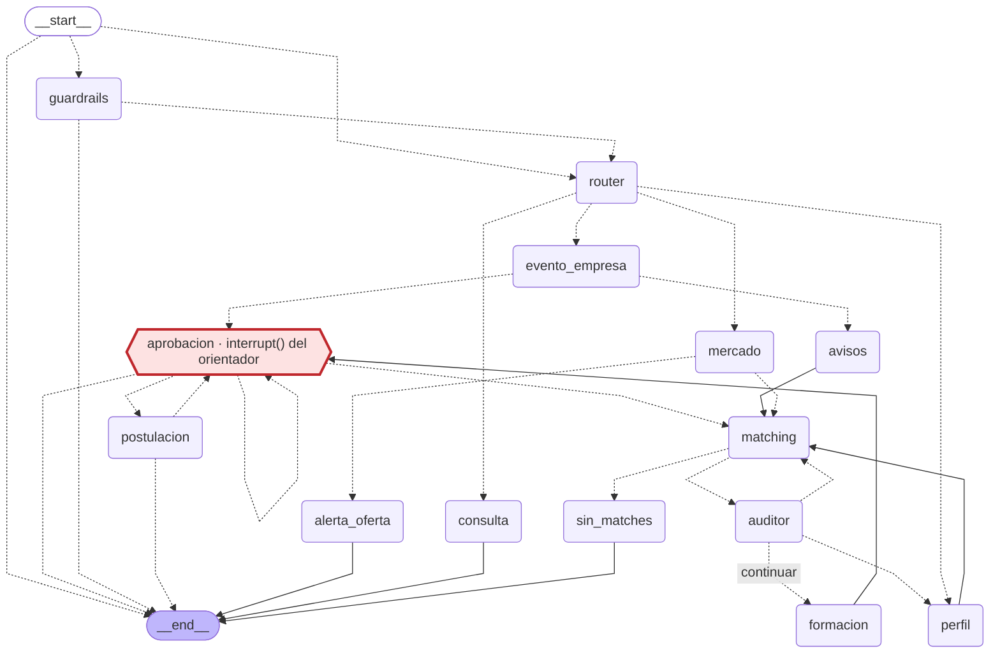

# Puente

<!-- Cambia el 0 por el número de su reto y deja la línea tal cual ("Reto: N"):
       1 = Agua · 2 = Educación · 3 = Empleabilidad
     No cambien de reto sin autorización de los organizadores. -->
Reto: 3

Sistema agéntico de inserción laboral juvenil: conecta jóvenes, vacantes y cursos con un solver que respeta traslado, horario y salario, y un orientador humano que aprueba antes de cualquier envío.

## Equipo

- Jesus Guerra (@jesus12ga)
- Cornelio Guerra (@Cornelio-Guerra)
- Miguel Vasquez (@Migue0714)

## Problema

En Panamá, la Encuesta de Mercado Laboral del INEC de **agosto de 2026** estimó una tasa de desocupación nacional de **8,5 %**. Para las personas de **20 a 24 años** fue **22,6 %**, y para las de **25 a 29 años**, **14,4 %**. El mismo boletín reportó **45,8 %** de empleo informal no agrícola. Son indicadores de contexto nacional, no resultados ni línea base de Puente: [comentario oficial](https://www.inec.gob.pa/archivos/P053342420260930151945Comentarios.pdf), [cuadro de desocupación por edad](https://www.inec.gob.pa/archivos/P0579518620260930152328Cuadro%205.pdf) y [boletín oficial, cuadro 26](https://www.inec.gob.pa/archivos/P0862619320260930153357Bolet%C3%ADn%20de%20la%20Encuesta%20de%20Mercado%20Laboral%20-%20Agosto%202026.pdf).

En **Panamá Oeste**, la provincia donde están Arraiján y La Chorrera (también Capira, Chame y San Carlos), el mismo [cuadro 5](https://www.inec.gob.pa/archivos/P0579518620260930152328Cuadro%205.pdf) da cifras peores para los jóvenes. Son tasas de desocupación de agosto de 2026:

| Grupo | Panamá Oeste | Todo el país |
| --- | ---: | ---: |
| 20 a 24 años | **31,1 %** (11 630 de 37 355 personas activas) | 22,6 % |
| Mujeres de 20 a 24 años | **35,4 %** (5 880 de 16 605) | 28,0 % |

Es la población a la que apunta la demo.

### Para quién es Puente

| Quién | Qué le pasa hoy | Qué gana con Puente |
| --- | --- | --- |
| **Joven de 18 a 29 años en Panamá Oeste** | Sabe hacer cosas que no están en ningún papel. Postula a anuncios que quedan a más de una hora, cuestan más pasaje del que puede pagar o chocan con sus clases. Algunos anuncios piden edad o sexo, y eso es ilegal. | Solo le llegan vacantes a las que llega en 60 minutos o menos, con pasaje dentro de su presupuesto y sin cruce con sus clases. Sus habilidades cuentan, cada una con una frase suya como evidencia. Su CV sale ciego y solo con su consentimiento. |
| **Empresa** | Recibe candidatos que después no pueden sostener el traslado o el horario. | Una lista corta de hasta 3 personas por plaza que cumplen traslado, pasaje, horario y salario, y el aviso si su anuncio choca con la Ley 11 de 2005. |
| **Orientador** | Revisa ofertas y perfiles a mano, sin saber por qué una opción conviene más que otra. | Decide al final, con el motivo de cada puntaje, las alertas del Auditor si un nombre o un género cambia el resultado y cursos del INADEH con cupo para las brechas. |

El reto que aborda esta demo es concreto: una persona joven puede tener habilidades adquiridas en trabajo informal sin un certificado que las haga visibles, mientras una oferta aparentemente cercana puede exigir un viaje o pasaje incompatible con su horario y presupuesto. Puente toma evidencia literal de esas habilidades, evalúa restricciones de traslado, horario y salario, y presenta al orientador humano una lista corta con motivos verificables. La demo usa perfiles y vacantes sintéticos; todavía no demuestra colocaciones ni reducción real del desempleo.

El [plan original de Jesús del 16 de octubre](docs/plan.md) se conserva como documento histórico. Sus cifras de septiembre de 2025 y tecnologías previstas describen la propuesta inicial; para el horario y los recortes vigentes manda [el issue #41](https://github.com/HackathonFISC/equipo-01/issues/41), y esta sección usa los datos oficiales más recientes.

### Cómo mediremos el impacto en la demo

`puente/metricas.py` calcula desde el desglose de los matches: (1) número de ofertas descartadas por traslado o pasaje y motivo; (2) diferencia mensual de minutos de ida y vuelta y de costo frente a **cada** oferta descartada con ruta conocida, con 22 días laborables por defecto, igual que el valor por defecto del solver; y (3) habilidades pedidas por una oferta asignada que el perfil respalda con evidencia literal. El rótulo de salida es **«Ilustrativo, datos de la demo»**. Las comparaciones son alternativas hipotéticas: no se suman entre ofertas ni se presentan como ahorro observado. Si falta una ruta o un match viable, no se calcula una diferencia. La evidencia literal no prueba por sí sola que una habilidad provenga de trabajo informal. Los traslados de la demo se documentan en [`data/FUENTES.md`](data/FUENTES.md); la estimación mensual depende de la cantidad de días laborables elegida.

### Antes y después: Yaritza (ilustrativo, datos de la demo)

**Yaritza** es un personaje ficticio (`data/perfiles/yaritza.json`):
- 20 años, vive en La Chorrera y estudia de lunes a viernes de 18:30 a 21:30;
- ayuda en la fonda de su mamá y no tiene CV;
- pide al menos B/. 600 al mes y puede gastar B/. 3,00 diarios en pasaje.

La comparación usa las **20 ofertas reales anonimizadas** de `data/ofertas/` (Computrabajo y Konzerta, 16 de octubre de 2026). Las cifras salen del filtro del Matching (`evaluar_factibilidad_par`) y del solver (`asignar`), sobre la base que deja `puente.cargar` en modo reproducir. No son resultados de campo.

| | Sin Puente | Con Puente |
| --- | --- | --- |
| **Qué revisa** | Los 20 anuncios, uno por uno. | 1 opción viable, con su motivo. |
| **Requisitos ilegales** | 7 anuncios piden edad o sexo (Ley 11 de 2005) y nadie le avisa. | Las 7 ofertas quedan bloqueadas antes de llegarle; el orientador ve la regla y la frase. |
| **Traslado** | 4 anuncios están en Juan Díaz o Tocumen: de 80 a 95 minutos de ida y B/. 4,70 diarios de pasaje, por encima de sus B/. 3,00. | Su mejor opción, *Auxiliar de servicio al cliente* en Arraiján (B/. 666 al mes), está a **30 minutos** y cuesta **B/. 2,00 diarios** (B/. 44,00 al mes por 22 días). |
| **Anuncios sin lugar claro** | 10 de los 20 anuncios no dicen en qué corregimiento es el trabajo; tendría que preguntar en cada uno. | No se le proponen: sin traslado medido, el Matching no los da por viables. |
| **Sus habilidades** | Sin CV, lo que hace en la fonda no aparece en ningún papel. | **3 habilidades con evidencia literal:** atención al cliente («atiendo pedidos»), manejo de caja («cobro en caja») e inventario («cuento los productos que quedan al cerrar»). La oferta propuesta pide atención al cliente. |
| **Lo que falta** | — | La opción cubre 1 de las 2 habilidades que pide la oferta y su horario no está publicado, así que queda «por confirmar» (puntaje 40). El orientador decide si la aprueba. |

Para reproducirlo, sin red ni clave:

```bash
LLM_MODO=reproducir uv run python -m puente.cargar --db yaritza.db
uv run python - <<'EOF'
import sqlite3
from puente.rules.traslados import cargar_traslados, indexar_traslados
from puente.schemas import Oferta, Perfil
from puente.solver.asignacion import ConfigSolver, evaluar_factibilidad_par

conn = sqlite3.connect("yaritza.db")
yaritza = Perfil.model_validate_json(conn.execute("SELECT datos_json FROM perfiles WHERE id='P01'").fetchone()[0])
indice = indexar_traslados(cargar_traslados())
for (datos,) in conn.execute("SELECT datos_json FROM ofertas ORDER BY id"):
    par = evaluar_factibilidad_par(yaritza, Oferta.model_validate_json(datos), indice, ConfigSolver())
    print(par["oferta_id"], "viable" if par["viable"] else par["motivo_str"])
EOF
```

### Nivel alcanzado: autonomía acotada y verificable

El **documento oficial de retos, sección 7 («Rúbrica base»)** asigna 25 % al diseño agéntico y pide mostrar roles, herramientas, autonomía, componente determinístico y «nivel alcanzado», pero **no publica una escala de niveles**. El taller de preparación *Introducción al Paradigma Agéntico · Prompting avanzado con OpenCode* (Ing. Carlos Rodríguez-Chong, labVIA, 22 de septiembre de 2026, diapositivas 8, 9, 12 y 13) distingue un chatbot que responde, un flujo que sigue pasos programados y un agente que elige la siguiente acción según el objetivo y el resultado. También describe el ciclo de acción y observación, y exige que la autonomía dependa de permisos y condiciones de parada. Usamos esos criterios para describir el comportamiento observable de Puente, sin atribuirle un grado numérico oficial.

Presentamos Puente como un **sistema agéntico de autonomía acotada**. Lo que el código actual hace, y dónde se ve:

- **Elige la ruta.** El [router](puente/graph.py) decide el camino según la entrada: oferta, perfil, consulta o respuesta de la empresa.
- **Se corrige.** El [Auditor](puente/agents/auditor.py) repite el caso con variantes de nombre, género y corregimiento. Si el resultado cambia, devuelve el caso **una vez**: a Perfil, si la diferencia viene de cómo se leyó el perfil, o a Matching. Si la diferencia persiste, se la entrega al orientador en vez de iterar.
- **Calcula sin LLM.** El [solver](puente/solver/asignacion.py) calcula las restricciones y el puntaje de forma determinística.
- **Se detiene ante el humano.** El grafo conserva estado con un checkpointer SQLite y se detiene con `interrupt()` en cada vacante. El orientador puede:
  - **aprobar**;
  - **editar** el mensaje a la empresa y su nota, sin recalcular;
  - **quitar** a un candidato, y el grafo recalcula;
  - **rechazar**.

  La aprobación exige el consentimiento confirmado de cada joven antes de Postulación. Postulación registra en SQLite y prepara el CV ciego, el mensaje y la cita.
- **Reacomoda (#54, logrado).** Cuando la empresa rechaza a un candidato o da la vacante por cubierta:
  - el grafo excluye esa pareja y avisa al joven;
  - recalcula la lista corta;
  - vuelve al `interrupt()` para que el orientador la apruebe.

  Se demuestra en la terminal (`--auto "…,empresa_rechaza:yaritza@of-cajero-vista-alegre,aprobar"`) y en la vista de la empresa, `/empresa/lista-corta` (#167). Lo cubren 17 pruebas en `tests/test_reacomodo.py` y 2 en `tests/test_empresa.py`.

Las rutas y los límites están definidos por código, y el envío depende de autorización humana. Perfil usa cinco preguntas fijas; la selección adaptativa de preguntas no se presenta como implementada. Si la organización aclara qué entiende por «nivel alcanzado», se ajustará esta sección con ese criterio.

## Cobertura del reto (sección 5.4)

Los siete agentes mínimos que sugiere el documento del reto y dónde están en Puente:

| Agente sugerido | En Puente | Issues | Estado |
|---|---|---|---|
| 1. Inteligencia de mercado: normalizar ofertas a una taxonomía, detectar requisitos, extraer tendencias | Mercado: extracción con Claude, habilidades normalizadas a la taxonomía enlazada a ESCO, reglas de la Ley 11 de 2005 en código, duplicados por similitud; el Redactor propone una versión legal de una oferta bloqueada | #5, #43, #157, #198 | Completo; tendencias con `uv run python -m puente.metricas --tendencias` (#198) |
| 2. Perfil: leer el CV y entrevistar para descubrir habilidades no declaradas | Perfil: CV o entrevista de 5 preguntas, cada habilidad con su frase literal de evidencia; vista `/joven` y chatbot de WhatsApp (sandbox de Twilio); la tirilla de matrícula da el horario de clases | #6, #44, #52, #160, #164, #166 | Completo, con preguntas fijas |
| 3. Matching: asignación con capacidades y restricciones de transporte, horario y salario | Solver OR-Tools CP-SAT con restricciones duras, hasta 3 candidatos por plaza (no por vacante) y hasta 2 vacantes por joven | #4, #48 | Completo |
| 4. Ruta de formación: plan de cursos con cupos, horarios, costo y transporte | Formación: set cover voraz (no óptimo) sobre cursos del INADEH con cupo, horario, costo y traslado | #14, #53 | Completo; cupos y horarios son datos de prueba |
| 5. Postulación: adaptar el CV, agendar entrevistas y enviar listas cortas | Postulación: CV y carta de presentación por oferta, sin datos sensibles (la carta, por plantilla y con la frase literal de cada habilidad), `.ics` de la entrevista, mensaje a la empresa por Telegram o `outbox/`; vista de la empresa | #7, #12, #123, #167, #212 | Completo: CV y carta |
| 6. Entrevista simulada con retroalimentación | No se construyó | — | Fuera de alcance |
| 7. Auditor: medir sesgo por nombre, género o corregimiento y bloquear ofertas discriminatorias | Auditor v2 con contrafactuales y línea base; el bloqueo lo hacen las reglas de Mercado | #8, #50, #5 | Completo |

**Fuera de alcance, y por qué.** La entrevista simulada daría como resultado la opinión de un LLM sobre una conversación, y no hay forma de verificarla en código en 24 horas. Priorizamos lo que sí se puede verificar: que nada salga sin aprobación y consentimiento.

**Tendencias del mercado (#198).** `puente/metricas.py` calcula en código las habilidades más pedidas, el salario por zona y los bloqueos de la Ley 11 sobre las ofertas de la base: `uv run python -m puente.cargar` y después `uv run python -m puente.metricas --tendencias`. Con las 20 ofertas de `data/`, atención al cliente es la más pedida (6).

## Arquitectura de agentes

LangGraph orquesta los agentes. Principio de diseño: **el LLM trabaja en los bordes y el código decide en el centro**. El LLM lee ofertas, CVs y entrevistas y redacta; el código normaliza, aplica las reglas legales, calcula traslados y horarios, asigna con CP-SAT, audita el sesgo y decide qué sale. El LLM nunca ordena candidatos, nunca calcula traslados y nunca decide si una oferta es legal. Metodología completa en [`docs/metodologia.md`](docs/metodologia.md).

Diagrama del grafo real, generado sin red con `draw_mermaid()`:

```bash
uv run python -c "from puente.graph import construir_grafo; print(construir_grafo().get_graph().draw_mermaid())"
```

A mano solo se marcó en rojo el nodo `aprobacion`, que es el `interrupt()` del orientador; el resto sale tal cual. Las flechas punteadas son aristas condicionales.



Cómo se lee:

- **Entrada.** Una entrada nueva pasa primero por `guardrails`. Una respuesta de la empresa entra directo al `router`, que la manda a `evento_empresa`.
- **Auditor.** Puede devolver el caso a `perfil` o a `matching` una sola vez; si no, sigue a `formacion`.
- **Aprobación.** `aprobacion` se repite por cada vacante. «Quitar» vuelve a `matching`; aprobar o editar pasa a `postulacion`, que regresa a `aprobacion` mientras queden vacantes por decidir.
- **Reacomodo.** `evento_empresa` y `avisos` hacen el reacomodo.

**Agentes y herramientas: qué decide el código y qué hace el LLM.**

| Componente | Código | Qué decide el código | Qué hace el LLM |
|---|---|---|---|
| Guardrails (#9, #56) | `puente/guardrails.py` | Rechaza archivos que no sean PDF, JPG o PNG o pasen de 5 MB, textos de más de 10,000 caracteres, edades fuera de 18 a 29, notas de voz y lo claramente fuera de alcance. Marca la inyección de instrucciones sin bloquear. Quita cédula, teléfono y dirección exacta antes de `graph.invoke` | Nada |
| Router (#10) | `puente/graph.py` | Elige la ruta: oferta, perfil, consulta o evento de la empresa | Nada |
| Mercado (#5, #43) | `puente/agents/mercado.py`, `puente/rules/discriminacion.py` | Bloquea por límite de edad (art. 2 de la Ley 11 de 2005) o por exigencia de sexo (art. 1) y alerta lo demás, siempre con la frase literal. Acepta el salario y el horario solo si están en el texto. Normaliza las habilidades a la taxonomía y une duplicados por similitud | Extrae los campos de la oferta en salida estructurada |
| Perfil (#6, #44) | `puente/agents/perfil.py` | Valida el formulario fijo. Descarta toda habilidad sin frase literal del joven o fuera de la taxonomía. Quita datos personales antes del prompt | Lee el CV o las 5 respuestas y propone habilidades con su frase |
| Matching (#4, #48) | `puente/solver/asignacion.py`, `puente/agents/matching.py` | CP-SAT con restricciones duras, desempate determinístico por id y explicación con plantilla. Restricciones: traslado <= 60 min, pasaje <= 15 % del salario y <= presupuesto diario, horario sin cruce, salario >= el mínimo del joven | Nada |
| Auditor (#8, #50) | `puente/agents/auditor.py` | Arma las variantes, repite el Matching con cada una, compara contra una línea base de 3 corridas y decide si devuelve el caso o avisa al orientador | Nada |
| Formación (#14, #53) | `puente/agents/formacion.py` | Filtra cursos por cupo, horario, traslado y pasaje, y elige con set cover voraz | Opcional, solo la explicación; apagado en el grafo y en el tablero |
| Orientador (#10, #49) | `interrupt()` en `puente/graph.py` | Una persona decide: aprobar, editar, quitar o rechazar, y confirma el consentimiento | Nada |
| Postulación (#7, #12) | `puente/agents/postulacion.py`, `puente/tools/` | Exige aprobación y consentimiento. Registra en SQLite y la tabla `decisiones`, arma el CV ciego (fpdf2) y el `.ics`, y envía por Telegram o deja todo en `outbox/` | Nada |
| Reacomodo (#54, #167) | `evento_empresa` y `avisos` en `puente/graph.py`; `app/empresa.py` | Excluye la pareja rechazada o la vacante cubierta, avisa al joven y recalcula | Nada |
| Redactor (#157) | `puente/agents/redactor.py` | Decide qué frases cambiar, verifica que la versión nueva pase las reglas y cuenta con el solver los candidatos viables antes y después | Redacta la versión legal de la oferta |
| Horario (#164) | `puente/agents/horario.py` | Valida los bloques y arma `horario_clases` | Lee la foto o el PDF de la tirilla de matrícula |
| Micromisión (#158) | `puente/agents/micromision.py` | Califica en código retos cortos por habilidad y arma un scorecard ciego con código anónimo | Extrae la respuesta del texto del joven; sin LLM, un respaldo con expresiones regulares |

Redactor y Micromisión se usan por línea de comandos y en los evals; todavía no están en el grafo ni en el tablero. Horario, además, lee la tirilla en `/joven`.

## Tecnologías y fuentes de datos

**Tecnologías.**

- Python 3.12 y [uv](https://docs.astral.sh/uv/).
- LangGraph para el grafo, con `interrupt()` y checkpointer SQLite (`langgraph-checkpoint-sqlite`).
- **LLM: Claude Opus 5.5** (`claude-opus-5-5`) con el SDK `anthropic`, detrás de la capa común [`puente/llm.py`](puente/llm.py) (#45). Gemini (`langchain-google-genai`) queda solo como proveedor opcional de respaldo.
- La capa común tiene tres modos:
  - **vivo**: llama al modelo;
  - **grabar**: llama y guarda la respuesta;
  - **reproducir**: lee la respuesta guardada, sin red ni clave.

  También tiene un tope de gasto por proceso.
- OR-Tools CP-SAT para la asignación.
- Pydantic para los contratos entre agentes.
- pypdf para leer PDFs, fpdf2 para el CV, `ics` para la cita y SQLite para las postulaciones, el embudo y las decisiones.
- Starlette y uvicorn para el tablero, con HTML, CSS y JS sin framework en `app/static/`.
- LangSmith para las trazas, sin entradas ni salidas.
- pytest.

**Fuentes de datos.** [`data/FUENTES.md`](data/FUENTES.md) documenta cada archivo y separa lo que es dato medido, dato de prueba y supuesto del equipo.

| Archivo | Qué es | Naturaleza |
|---|---|---|
| `data/traslados.csv` | Minutos a hora pico (07:00) y pasaje entre 13 nodos de Panamá Oeste, centro, San Miguelito y Panamá Este. Fuentes: Google Maps Transit y Moovit (2026-10-16), y tarifas de MiBus, el Metro y la ATTT | Dato medido |
| `data/taxonomia.csv` | 51 habilidades con `skill_id` y sinónimos; 47 enlazadas a su URI de ESCO v1.2.1 | Estándar ESCO y supuestos del equipo |
| `data/ofertas/` | 20 anuncios reales de Computrabajo y Konzerta (2026-10-16), con las condiciones publicadas y nombres de empresa de prueba | Dato real anonimizado |
| `data/perfiles/` | 10 perfiles de 18 a 29 años, incluida Yaritza | Sintético |
| `data/cursos.csv` | 9 cursos con títulos y áreas reales del INADEH | Cupos y horarios de prueba |
| `data/retos.csv` | Retos cortos por habilidad de Micromisión (#158) | De prueba |
| `data/grabaciones/`, `evals/grabaciones/` | Respuestas grabadas de Claude para la demo y los evals sin red | Generado |

Supuestos del equipo, configurables en el solver: 60 minutos por trayecto, pasaje de hasta 15 % del salario, 22 días laborables al mes y la misma duración y tarifa a la ida y a la vuelta.

## Instalación y ejecución

Requisitos: [uv](https://docs.astral.sh/uv/). `uv` descarga Python 3.12 si no está instalado. **Nada de lo que sigue necesita claves ni red**: `.env.example` trae `LLM_MODO=reproducir`, y la capa de LLM lee las respuestas grabadas.

```bash
git clone https://github.com/HackathonFISC/equipo-01.git
cd equipo-01
uv sync
cp .env.example .env
uv run pytest -q
```

**Modo sin red.** Con `LLM_MODO=reproducir` (el valor de `.env.example`) ningún agente llama a la red; si falta una grabación, el agente falla con un mensaje que dice cuál es, en vez de llamar al modelo. Hay dos excepciones: Micromisión usa su respaldo con expresiones regulares (`"metodo": "respaldo"`) y el Redactor cae a su plantilla. En Windows, si la salida va a un archivo o a otra consola, antepón `PYTHONUTF8=1` para que los acentos y los símbolos no corten la salida. Sin `.env`, exporta `LLM_MODO=reproducir` antes de cada comando, porque el valor por defecto de `puente/llm.py` es `vivo`.

**1. El caso de Yaritza en la terminal.** Recorre todo el grafo con los agentes reales y sus respuestas grabadas, y se detiene en cada vacante para preguntar qué hace el orientador.

```bash
uv run python -m puente.graph
```

Sin preguntas, con aprobación, rechazo de la empresa y reacomodo:

```bash
uv run python -m puente.graph --auto "aprobar,aprobar,empresa_rechaza:yaritza@of-cajero-vista-alegre,aprobar"
```

El CV ciego, el `.ics` y los mensajes quedan en `outbox/` (o en `PUENTE_OUTBOX`) y la base en `puente.db` (o en `PUENTE_DB`). Telegram solo sale con `--telegram`.

**2. La extracción real de Mercado sobre las 20 ofertas.** Las pasa por Mercado con las respuestas grabadas de Claude y las guarda en `puente.db`, junto con 10 perfiles. La primera corrida imprime «ofertas: 20 leídas con el LLM, 0 desde cargas · en la base: 20 (7 bloqueadas)». Las siguientes reutilizan lo ya extraído.

```bash
uv run python -m puente.cargar
```

**3. El tablero.** Se abre en http://127.0.0.1:8000.

```bash
uv run python -m app.server
```

- **`/`**: tablero del orientador. Muestra la lista corta por vacante, las ofertas bloqueadas con su motivo, el reporte del Auditor, las métricas de impacto y las trazas.
- **`/joven`**: el joven llena el formulario, hace la entrevista de una vez o por chat, sube su tirilla de matrícula, da su consentimiento y sigue sus postulaciones. Detalle en [Vista del joven](#vista-del-joven-joven).
- **`/empresa/lista-corta`**: la empresa ve su lista corta ciega y puede aceptar, rechazar o dar la vacante por cubierta; rechazar o cubrir dispara el reacomodo.

Los códigos de acceso de `/joven` y `/empresa/lista-corta` se imprimen en la consola al arrancar y en cada reinicio.

**4. Agentes por línea de comandos**, también sin red:

```bash
uv run python -m puente.agents.redactor --oferta OF-BLOQ-EDAD-04 --llm plantilla
uv run python -m puente.agents.micromision --skill manejo_caja --texto "Le doy 5.45 de vuelto"
uv run python -m puente.agents.horario tests/fixtures/tirilla_sintetica.png --hoy 2026-10-17
```

La entrevista de Perfil por terminal pide respuestas nuevas, así que necesita `LLM_MODO=vivo` y `ANTHROPIC_API_KEY`:

```bash
uv run python -m puente.agents.perfil --entrevista
```

**5. Los evals.**

```bash
uv run python -m evals.run
```

## Vista del joven (`/joven`)

`uv run python -m app.server` sirve el tablero del orientador en `/` y la vista del joven en `/joven`. El joven llena el formulario fijo y hace la entrevista de 5 preguntas, en un solo envío (#52) o por chat, una pregunta a la vez (#166). Después puede subir la foto o el PDF de su tirilla de matrícula para anotar sus clases (#164), decidir si acepta cada envío y seguir sus postulaciones: el embudo por vacante, el aviso cuando la empresa no sigue (#54), el `.ics` de la entrevista propuesta y su «no», que manda sobre el orientador (#109).

| Ruta | Qué hace |
|---|---|
| `POST /api/joven/entrevista` | Abre la entrevista por chat con el formulario fijo y entrega el código |
| `GET` / `POST /api/joven/{id}/entrevista` | Pregunta que sigue / manda una respuesta (limpia de PII y con guardrails) |
| `POST /api/joven/{id}/entrevista/terminar` | El agente Perfil arma el perfil y lo deja listo en el tablero |
| `POST /api/joven/{id}/tirilla` | Lee la tirilla (base64 en JSON, hasta 5 MB) y devuelve los bloques con sus problemas |
| `POST /api/joven/{id}/tirilla/confirmar` | Guarda los bloques confirmados y recalcula el Matching; la imagen no se guarda |
| `GET /api/joven/{id}/postulaciones` | Embudo por vacante, avisos del reacomodo, `.ics` y el «no» del joven |

Con `LLM_MODO=reproducir` (sin red) solo se leen las entradas que tienen grabación: en el chat, el botón «Usar la respuesta de Yaritza», y la tirilla `tests/fixtures/tirilla_sintetica.png`. Con otras respuestas el agente Perfil responde con un error claro y no inventa el perfil.

**Limitación de la demo: no hay login.** El joven se identifica con un código `PERFIL-….<token>` que recibe al abrir la entrevista. El token viaja en el encabezado `X-Token-Joven` y, en la página, en el fragmento `#codigo=` de la URL, que el navegador no manda al servidor (el enlace `.ics` de la fase 1 aún lo lleva en la URL). Quien tenga el código ve y decide por ese perfil. Los códigos de los perfiles semilla salen en la consola del servidor. Una entrevista por chat sin terminar vive en memoria: si el servidor se reinicia, se empieza de nuevo.

## Chatbot de WhatsApp (sandbox de Twilio, #160)

El joven también puede hacer la entrevista por WhatsApp. El bot es solo un canal: pide el mismo formulario fijo (nombre, edad, corregimiento, horario de clases, horario para trabajar, salario y pasaje) y las mismas 5 preguntas de `/joven`, y el perfil sale por el mismo camino (`preparar_entrada_joven`, guardrails, agente Perfil, `registrar_perfil_joven`). Al terminar contesta «perfil listo» y pregunta SÍ o NO por cada vacante de su lista corta. Un SÍ deja marcada la casilla «El joven consintió» en el tablero. Un NO deja la postulación en `no_seleccionado`, no se envía nada y Aprobar responde 422. Solo texto: las notas de voz y los archivos son la fase 2.

Es el **sandbox de Twilio**: un número compartido, gratis, solo para pruebas, que únicamente habla con teléfonos que se unieron con «join <palabra>». La API oficial de Meta exige verificar el negocio. Para recibir mensajes hace falta una URL pública. Vercel no sirve: allí el estado vive en `/tmp` y se pierde entre invocaciones, así que la conversación no sobrevive de un mensaje al siguiente, y además el LLM queda en `reproducir`. Por eso el webhook corre en la laptop de la demo detrás de un túnel:

1. En la consola de Twilio: *Messaging → Try it out → Send a WhatsApp message*. Desde el teléfono de prueba se envía `join <palabra>` al +1 415 523 8886.
2. En `.env`: `TWILIO_ACCOUNT_SID`, `TWILIO_AUTH_TOKEN` y `TWILIO_WHATSAPP_FROM=whatsapp:+14155238886`. Para entrevistas nuevas también `LLM_MODO=vivo` y `ANTHROPIC_API_KEY`: en `reproducir`, Perfil solo lee respuestas grabadas, igual que en `/joven`.
3. Servidor: `uv run python -m app.server`, que lee `.env` al arrancar sin pisar lo que ya esté exportado. `uv run --env-file .env python -m app.server` también sirve. Túnel, en otra terminal:

   ```bash
   cloudflared tunnel --url http://localhost:8000
   ```

4. Se copia la URL `https://….trycloudflare.com` que imprime cloudflared a `PUBLIC_BASE_URL` en `.env` y se reinicia el servidor.
5. En la consola de Twilio, *Sandbox settings → When a message comes in*: `https://….trycloudflare.com/api/whatsapp`, método `POST`.
6. Desde el teléfono: «hola». El bot responde con el saludo y la primera pregunta.

**Sin pagar Twilio: el número de prueba de Meta.** Si Twilio pide subir de plan para el sandbox, el mismo bot corre sobre la WhatsApp Cloud API con el número de prueba gratis de Meta, que admite hasta 5 destinatarios verificados. La ruta es `/api/whatsapp/meta`:

1. En developers.facebook.com: *My Apps → Create app*, caso de uso «Connect with customers through WhatsApp», y se agrega el producto WhatsApp.
2. En *WhatsApp → API Setup* se copian el token temporal (dura 24 h) y el *Phone number ID*. En *To* se agrega el teléfono de prueba y se verifica con el código que Meta manda por WhatsApp.
3. En *App settings → Basic* se copia el *App secret*.
4. En `.env` van `META_WHATSAPP_TOKEN`, `META_WHATSAPP_PHONE_NUMBER_ID`, `META_APP_SECRET` y un `META_WEBHOOK_VERIFY_TOKEN` inventado. No hace falta reiniciar el servidor: lee `.env` de nuevo si le falta una clave.
5. En *WhatsApp → Configuration → Webhook*: *Callback URL* `https://….trycloudflare.com/api/whatsapp/meta` y el mismo *Verify token*, luego *Verify and save*. En *Webhook fields* hay que suscribir `messages`.
6. Desde el teléfono, «hola» al número de prueba que aparece en *API Setup → From*.

Meta no acepta la respuesta en el cuerpo del webhook, como sí hace el TwiML de Twilio: el servidor contesta 200 de inmediato y los mensajes del bot salen por la Graph API en una tarea de fondo. La firma `X-Hub-Signature-256` es un HMAC-SHA256 del cuerpo con el *App secret*. Sin `META_APP_SECRET` la ruta responde 503 y con una firma inválida, 403. Los mensajes que Meta reintenta se reconocen por su id y no avanzan el guion dos veces.

**Seguridad y datos.** `POST /api/whatsapp` exige la firma `X-Twilio-Signature`: un HMAC-SHA1 de la URL pública más los parámetros ordenados. Sin `TWILIO_AUTH_TOKEN` responde 503 y con una firma inválida, 403. Si sale 403 con el teléfono, la consola del servidor dice qué URL se usó para verificar la firma, que casi siempre es la causa: `PUBLIC_BASE_URL` viejo tras abrir un túnel nuevo. El número no se guarda: la conversación vive en la tabla `whatsapp_conversaciones` de `puente.db` bajo el SHA-256 del número. Ninguna `Decision` lo lleva, y el respaldo en `outbox/` se llama `whatsapp_<prefijo del hash>_*.txt`. El SHA-256 de un teléfono es un seudónimo, no anonimato: con tiempo se puede revertir probando números. Cada mensaje pierde cédula, teléfono y dirección antes de guardarse y pasa por guardrails: la inyección solo se marca. Las respuestas se borran de la conversación al armar el perfil y quedan solo en `entradas_perfil`, como las de `/joven`.

**Modo demo pública.** Con `PUENTE_DEMO_PUBLICA=1` el tablero es de solo lectura (#161). Las únicas excepciones son `POST /api/whatsapp` y `POST /api/whatsapp/meta`, y solo con una firma válida de Twilio o de Meta: así la laptop puede exponerse por el túnel sin que nadie escriba en el tablero. En ese modo el LLM queda en `reproducir`, de modo que una entrevista nueva por WhatsApp no arma el perfil: el bot pide disculpas y lo dice. Para la demo en vivo, el servidor corre sin `PUENTE_DEMO_PUBLICA`, y la URL del túnel se pone solo en la consola de Twilio y se cierra al terminar, porque esa URL expone el tablero completo.

## Credenciales de demo

Solo existe [`.env.example`](.env.example), sin claves reales: se copia a `.env`, que nunca se sube. Para la demo sin red no hace falta llenar nada. Variables:

| Variable | Para qué sirve |
|---|---|
| `ANTHROPIC_API_KEY` | Clave de Claude; solo para `LLM_MODO=vivo` o `grabar` |
| `ANTHROPIC_WORKSPACE_ID` | Solo si la clave no es de un workspace (`sk-ant-usr-`) |
| `LLM_PROVEEDOR` | `anthropic` (por defecto) o `gemini` |
| `PUENTE_MODELO_LLM` | Vacío: `claude-opus-5-5` con anthropic y `gemini-2.5-flash` con gemini |
| `LLM_MODO` | `reproducir` (sin red ni claves), `grabar` o `vivo` |
| `LLM_DIR_GRABACIONES` | Carpeta de grabaciones; por defecto `data/grabaciones` |
| `LLM_PROVEEDOR_RESPALDO`, `LLM_MODELO_RESPALDO` | Segundo intento si el modelo se niega a responder |
| `PUENTE_LLM_FALLBACKS` | Respaldo del servidor de Anthropic (beta); dejar en `false` |
| `PUENTE_LLM_TOPE_USD` | Tope estimado de gasto en llamadas reales por proceso; reproducir no gasta |
| `GOOGLE_API_KEY` | Solo con `LLM_PROVEEDOR=gemini` |
| `LANGSMITH_API_KEY`, `LANGSMITH_TRACING`, `LANGSMITH_PROJECT` | Trazas en LangSmith (proyecto `puente`) |
| `LANGSMITH_HIDE_INPUTS`, `LANGSMITH_HIDE_OUTPUTS` | En `true`, las trazas no guardan entradas ni salidas con datos personales (#56) |
| `TELEGRAM_BOT_TOKEN`, `TELEGRAM_CHAT_ID_EMPRESA` | Bot y chat de la empresa de demo. Sin ellos, los mensajes van a `outbox/` |
| `TELEGRAM_CHATS_JOVENES` | Un chat por joven (`perfil_id=chat_id`); quien no esté recibe su aviso en `outbox/` |
| `PUENTE_DB` | Base SQLite; por defecto `puente.db`. El tablero, sin esta variable, usa `%TEMP%/puente_tablero.db` |
| `PUENTE_OUTBOX` | Carpeta del CV ciego, el `.ics` y los mensajes; por defecto `outbox/`. Vale para la terminal y para los avisos del reacomodo del tablero; el resto del tablero escribe en `outbox/` de la raíz hasta que entre el #207 |
| `PUENTE_ENTREVISTA_INICIO` | Fecha ISO 8601 de la entrevista; vacía, mañana a las 10:00, marcada como provisional |
| `PUENTE_SAL_ANONIMO` | Clave del código anónimo del scorecard (#158); vacía, una al azar por proceso |
| `TWILIO_ACCOUNT_SID`, `TWILIO_AUTH_TOKEN`, `TWILIO_WHATSAPP_FROM` | Chatbot de WhatsApp por el sandbox de Twilio (#160). Sin token, el webhook no atiende; sin cuenta o sin red, los mensajes del bot van a `outbox/` |
| `PUBLIC_BASE_URL` | URL pública del túnel, sin barra final; con ella se verifica la firma de Twilio. Vacía, se reconstruye con `X-Forwarded-Proto` y `Host` |
| `META_WHATSAPP_TOKEN`, `META_WHATSAPP_PHONE_NUMBER_ID`, `META_APP_SECRET`, `META_WEBHOOK_VERIFY_TOKEN`, `META_GRAPH_VERSION` | El mismo bot por el número de prueba gratis de Meta (WhatsApp Cloud API), en `/api/whatsapp/meta` |

## Lo que se puede verificar

Cada afirmación de diseño tiene una prueba que cualquiera puede repetir:

- **Sin LLM en el solver ni en las reglas.** El comando siguiente da **0** coincidencias:

  ```bash
  grep -rnE "anthropic|langchain|puente\.llm|ChatGoogle|generar_estructurado|generar_texto" puente/solver puente/rules
  ```
- **El salario no se inventa.** `verificar_salario()` en [`puente/agents/mercado.py`](puente/agents/mercado.py) acepta la cifra del LLM solo si aparece en el texto de la oferta, como mensual o como quincena. Si no, queda vacía con la nota «esa cifra no aparece en la oferta». Pruebas: `test_verificar_salario_contra_el_texto` y `test_konzerta_sin_salario_publicado_no_inventa_salario`.
- **Nada sale sin aprobación y consentimiento.** `postular()` en [`puente/agents/postulacion.py`](puente/agents/postulacion.py) valida primero la aprobación: orientador, hora y parejas aprobadas. Después exige el último consentimiento de cada joven («Sin consentimiento del joven no se envía nada (Ley 81 de 2019)»), antes de cualquier efecto. Pruebas: `test_sin_aprobacion_no_se_hace_nada` y `test_aprobacion_incompleta_no_se_hace_nada` en `tests/test_postulacion.py`, y el caso sin consentimiento en `tests/test_nodo_postulacion.py`.

  En el tablero, `POST /api/orientador/accion` responde **422 sin efectos** en tres casos: si falta el consentimiento, si el joven dijo «no» en `/joven` o si el Auditor marcó sesgo en el lote (#189). Lo cubre `tests/test_tablero.py`.
- **La Ley 11 de 2005, con la frase.** Cada hallazgo de [`puente/rules/discriminacion.py`](puente/rules/discriminacion.py) guarda la regla y la frase literal de la oferta. Solo bloquean el límite de edad (art. 2) y la exigencia de sexo (art. 1), y las demás causales del art. 1 alertan citando el artículo. «Buena presencia», foto y estado civil solo alertan, sin artículo, porque la ley no menciona la apariencia. Lo cubren los 25 casos de requisitos discriminatorios de los evals.
- **CV ciego.** `cegar()` en [`puente/tools/pdf.py`](puente/tools/pdf.py) quita de la evidencia que llega a la empresa la edad, la fecha de nacimiento, el corregimiento, el estado civil, la pareja, los hijos, el embarazo y los términos de género. El CV nunca lleva el presupuesto, el salario mínimo pedido ni las ofertas descartadas. La carta de presentación ([`puente/tools/carta.py`](puente/tools/carta.py), #212) pasa por lo mismo: se arma por plantilla, sin LLM, solo con habilidades que tienen evidencia. La evidencia y el nombre de cada habilidad pasan por `cegar()`; el texto de la oferta (empresa y puesto) no, porque tapar ahí el corregimiento del joven se lo revelaría a la empresa (pruebas en `tests/test_carta.py`).
  - El nombre, por decisión de @jesus12ga del 16 de octubre (#123), va o no según lo que mande la persona: Puente no lo agrega ni lo quita, y todo lo demás de esta lista sí se oculta.
  - La vista de la empresa sí lo quita: allí cada persona es «Candidato N».
  - Pruebas en `tests/test_cv_ciego.py`.
- **Demo reproducible sin red.** El grafo, la carga de ofertas y los evals corren con `LLM_MODO=reproducir`. `tests/test_grabacion_yaritza.py` falla si la grabación de Yaritza deja de corresponder al código.

## Lo que todavía no hace

- **En el tablero, Mercado con LLM solo entra por «Cargar un ejemplo desde `data/`».** Ese botón pasa los anuncios de `data/ofertas/` por Mercado con sus grabaciones, sin red: las 7 que chocan con la Ley 11 quedan bloqueadas, cinco por edad (CT02, CT24, CT40, CT46 y CT54), K02 por edad y sexo, y K03 por sexo (#205, #211). Los perfiles de `data/perfiles/` entran tal cual, con su evidencia y su horario. «Analizar una oferta nueva», el registro de perfiles y las 5 ofertas iniciales siguen con los stubs de `_compilar_grafo_tablero()` en [`app/server.py`](app/server.py), y las entradas rotuladas «ejemplo sintético (no es un archivo)» son de prueba. Matching, Auditor, Formación y Postulación sí son los reales.
- **`/joven` sí llama a Perfil y a Horario con el LLM.** En modo reproducir solo lee lo que tiene grabación: la respuesta de Yaritza y la tirilla sintética. Con texto nuevo hace falta `LLM_MODO=vivo` y `ANTHROPIC_API_KEY`; sin eso responde con un error claro y no inventa el perfil.
- **Telegram en el tablero.** El tablero no tiene un interruptor de Telegram como el `--telegram` de la terminal: si el entorno trae `TELEGRAM_BOT_TOKEN` y `TELEGRAM_CHAT_ID_EMPRESA`, la lista corta sale de verdad.
- **WhatsApp, fase 1.** El bot hace la entrevista y pide el consentimiento, pero el resultado y el `.ics` tras la aprobación siguen saliendo por Telegram u `outbox/`, no por WhatsApp. Las notas de voz y los archivos tampoco entran todavía. El número del joven vive solo en memoria mientras se arma su perfil: el bot no puede escribirle por su cuenta después, solo responderle.
- **Variación del LLM.** Los evals en modo reproducir usan una grabación por caso; no miden la variación entre corridas del LLM.

## Guardrails y datos personales

Las palabras clave de inyección ("ignora tus instrucciones", "eres ahora", "system prompt") solo **marcan** el texto, que sigue como dato; no bloquean nada, porque una lista de palabras se esquiva con facilidad. La defensa real es estructural: el LLM responde con salida estructurada que se valida con Pydantic, y las decisiones que importan (orden de candidatos, traslados, legalidad de una oferta) se toman en código. Antes de `graph.invoke`, `limpiar_entrada()` de `puente/guardrails.py` quita cédula, teléfono y dirección exacta. Así el dato crudo no llega al checkpoint, a `decisiones`, al LLM ni a LangSmith, que además corre con `LANGSMITH_HIDE_INPUTS` y `LANGSMITH_HIDE_OUTPUTS`. Las notas de voz se rechazan por ahora con un mensaje claro.

## Evals

62 casos propios en [`evals/casos.yaml`](evals/casos.yaml), cada uno con el resultado esperado escrito antes de correr. El runner es [`evals/run.py`](evals/run.py) y los resultados, con el registro de fallos y su historial, están en [`evals/resultados.md`](evals/resultados.md). Esta tabla es de la corrida en modo reproducir sobre `main`. **Se regenera con `uv run python -m evals.run` sobre el commit final, antes del tag.**

| Categoría | Casos | Aciertos | Métrica | Meta | Cumple |
|---|---:|---:|---|---:|---|
| Extracción de ofertas | 5 | 5/5 | Campos esperados todos correctos (puesto, empresa, corregimiento, salario, habilidades) | 80 % | sí |
| Requisitos discriminatorios | 25 | 25/25 | Bloqueo, artículo y alertas iguales a lo esperado | 100 % | sí |
| Perfil sin CV | 4 | 4/4 | Habilidades esperadas con evidencia literal y ninguna sin evidencia | 75 % | sí |
| Matching factible | 3 | 3/3 | Asignación igual a la calculada a mano y 0 violaciones duras | 100 % | sí |
| Sesgo contrafactual | 3 | 3/3 | Detección de sesgo igual a lo esperado | 100 % | sí |
| Guardrails | 7 | 7/7 | Veredicto igual a lo esperado, sin llamar al LLM cuando se rechaza | 100 % | sí |
| Horario: tirilla | 1 | 1/1 | Horario de clases, excepciones y vigencia exactos | 100 % | sí |
| Horario: validación | 1 | 1/1 | Bloques inválidos rechazados y válidos convertidos | 100 % | sí |
| Redactor | 3 | 3/3 | Versión legal sin hallazgos y viables antes y después iguales a lo calculado a mano | 100 % | sí |
| Micromisión | 4 | 4/4 | Puntaje calculado en código, igual con nombre y género cambiados, scorecard sin datos personales | 100 % | sí |
| Postulación | 2 | 2/2 | Sin consentimiento no sale nada; con consentimiento, CV, carta, .ics y mensaje sin datos sensibles | 100 % | sí |
| Reacomodo | 1 | 1/1 | Tras el rechazo de la empresa: pareja excluida, aviso al joven y nueva aprobación pendiente | 100 % | sí |
| Formación | 2 | 2/2 | Cursos calculados a mano, con cupo, horario sin cruce, traslado de hasta 60 min y pasaje dentro del presupuesto | 100 % | sí |
| De punta a punta | 1 | 0/1 | Listas cortas calculadas a mano y CV, carta e .ics por pareja en outbox, sin datos sensibles | 100 % | no (#238) |

Para leer esta tabla con honestidad:

- **No siempre fue así.** El 16 de octubre, 4 de los 5 casos de extracción fallaban (#152 a #155). Se corrigieron en el código de Mercado, sin tocar lo esperado, y el historial queda en `evals/resultados.md`.
- **Un caso falla hoy.** E2E-01 recorre el caso Yaritza de punta a punta. Coinciden las parejas enviadas, los archivos y la ausencia de datos sensibles, pero la lista corta de la cocina sale ordenada por id (Carlos 50, María 50, Yaritza 100) y no por puntaje. El fallo queda anotado y se sigue en #238.
- **Las metas son provisionales.** Las propuso el equipo.
- **No se mide la variación.** En modo reproducir cada caso con LLM usa una sola grabación.
- **Todos los datos de los casos son sintéticos.**

## Bitácora de IA

Qué partes se hicieron con IA, con qué herramienta y qué se modificó a mano. El registro completo, una fila por bloque de trabajo y escrito en el momento, está en [`docs/bitacora_ia.md`](docs/bitacora_ia.md). Su [resumen](docs/bitacora_ia.md#resumen), calculado el 2026-10-17 a la 01:27, cuenta por persona, por herramienta y por issue. En cifras:

- **Entradas.** 212 filas, de las que 17 son copias que dejó la mezcla por unión de varias ramas, marcadas como **duplicada**. Quedan **195 entradas**.
- **Por herramienta:**
  - Claude Code: 155 entradas (Opus 5.5, Sonnet 5.5 y Fable 5.1);
  - Codex: 21;
  - Antigravity (Gemini): 18;
  - sin IA: 1.
- **Por persona:** Jesus, 92; Cornelio, 85; Miguel, 18.
- **«Qué se cambió a mano».** 84 entradas lo dicen, como la calibración de traslados, la revisión de tarifas o una decisión de diseño. **111 todavía no**:
  - 75 dicen «nada todavía»;
  - 35 dicen «Pendiente de revisión en el PR»;
  - 1 está vacía.

La mayor parte del código la generaron agentes de IA. Las personas hicieron cuatro cosas:

- decidieron el alcance, el reparto y las reglas de trabajo;
- revisaron PRs;
- verificaron datos y cifras en sus fuentes;
- fijaron cuándo se fusiona: con revisión de otra herramienta o de un compañero, y con las pruebas en verde.

Las filas sin «qué se cambió a mano» se dejan como están: la bitácora se escribe en el momento y no se reescribe al final; cada persona completa las suyas.

## Flujo de trabajo

Protocolo completo para humanos y agentes de IA (Claude Code, Codex, Antigravity): [`AGENTS.md`](AGENTS.md). Resumen:

1. Cada tarea es un issue (plantilla *Tarea*); cada fallo, un issue con la plantilla *Fallo*.
2. Antes de trabajar se reclama el issue con `scripts/reclamar.sh N descripcion`, que lo marca `estado: en proceso` y crea la rama `issue-N-descripcion` con su worktree. Si ya está en proceso, se toma otro. Nadie empuja directo a `main`.
3. PR con `Closes #N` (`scripts/entregar.sh N`); otro integrante o Claude lo revisa antes de fusionar.
4. Claude revisa issues y PRs; sus correcciones van en su propia rama `claude/issue-N-...` con un PR aparte, sin tocar ramas ajenas.
5. Todo uso de IA se anota en `docs/bitacora_ia.md` en el momento con `scripts/bitacora.sh N "qué se pidió" "qué se cambió a mano"`; el hook pre-commit no deja commitear código sin su fila.
6. Código congelado a las 11:30 del 17 de octubre; tag `final-24h` a las 11:45, nunca después de las 12:00. Después de eso no se empuja nada (horario en #41).

---

Entrega: tag de git `final-24h` sobre el último commit válido, a las 11:45 del 17 de octubre, antes de la hora límite de las 13:00 (horario en #41).
