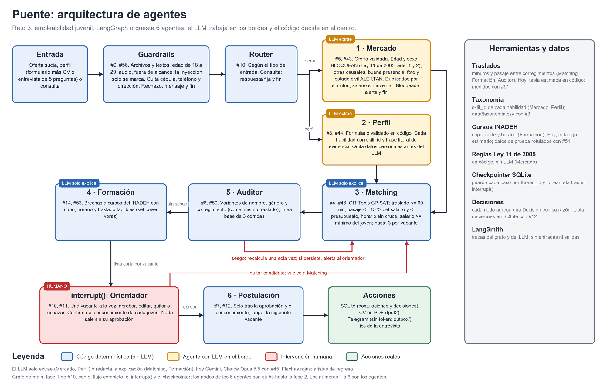

# Puente

<!-- Cambia el 0 por el número de su reto y deja la línea tal cual ("Reto: N"):
       1 = Agua · 2 = Educación · 3 = Empleabilidad
     No cambien de reto sin autorización de los organizadores. -->
Reto: 3

Sistema agéntico de inserción laboral juvenil: conecta jóvenes, vacantes y cursos con un solver que respeta traslado, horario y salario, y un orientador humano que aprueba antes de cualquier envío.

## Equipo

- Jesus Guerra (@jesus12ga)
- Cornelio Guerra (@Cornelio-Guerra)
- Miguel Vasquez (@Migue0714)

## Problema

En Panamá, conseguir el primer empleo formal es más difícil para quien tiene menos de 30 años, y no solo por falta de vacantes. Las ofertas llegan sucias (anuncios que piden edad o sexo, requisitos vagos), los jóvenes no tienen CV y casi nadie calcula si el traslado y el pasaje hacen viable el trabajo.

Cifras con su fuente (verificadas en la fuente el 2026-10-16; #47 amplía esta sección y las vuelve a verificar antes de la entrega):

- Desempleo nacional de 10.4 % en septiembre de 2025, frente a 9.7 % en octubre de 2024, e informalidad no agrícola de 47.1 %. De los jóvenes de 15 a 19 años en la fuerza laboral, 20,378 estaban desocupados (24.3 %), la tasa más alta de todos los grupos de edad. Fuente: INEC, Encuesta de Mercado Laboral, septiembre de 2025 ([comentario del INEC](https://www.inec.gob.pa/archivos/P053342420260304095947Comentario%20Sept%202025.pdf)).
- Una nota de EFE del 29 de septiembre de 2026 reporta, con datos del INEC, 8.5 % de desempleo y 45.8 % de informalidad a agosto de 2026 ([EyN/EFE](https://www.revistaeyn.com/empresasymanagement/panama-desempleo-baja-a-85-e-informalidad-laboral-al-458-hasta-agosto-FI32189158)). Se usará cuando se confirme en el INEC (pendiente de #47). El desempleo de 15 a 29 años no se cita hasta encontrarlo en los cuadros del INEC.
- La Ley 11 de 2005 (Gaceta Oficial 25287) prohíbe en el art. 2 los anuncios de empleo que exijan una edad; el art. 1 cubre sexo, raza, discapacidad y otros motivos. No menciona la apariencia ([texto de la ley](https://panama.justia.com/federales/leyes/11-de-2005-apr-27-2005/gdoc/)).
- El INADEH abrió 1,663 cursos gratuitos desde el 5 de octubre de 2026 ([TVN](https://www.tvn-2.com/nacionales/inadeh-abre-1-600-cursos_1_2264127.html)).
- La Línea 3 del Metro (Panamá Oeste) empezó pruebas en abril de 2026 y se espera que opere en 2028 ([Prensa](https://www.prensa.com/sociedad/metro-inicia-las-primeras-pruebas-del-monorriel-de-la-linea-3/)). Mientras tanto, el traslado desde La Chorrera y Arraiján sigue siendo una barrera práctica.

Cualquier otra cifra va como [CIFRA PENDIENTE · fuente]: no se publican números sin fuente.

**Caso guía: Yaritza.** 20 años, vive en La Chorrera, estudia de noche, no tiene CV y atiende la fonda de su mamá. Es un perfil sintético. Puente arma su perfil con lo que sí sabe hacer, cada habilidad con la frase suya que la evidencia. Descarta las vacantes que no puede alcanzar en 60 minutos, las que chocan con sus clases y aquellas cuyo pasaje pase del 15 % del sueldo o de su presupuesto diario. La propone en la lista corta de las que sí son viables y le sugiere un curso del INADEH para la brecha que le falta. Un orientador humano aprueba, y confirma que ella consiente, antes de que algo salga hacia una empresa.

## Cobertura del reto

Agentes mínimos que sugiere el reto (sección 5.4) y dónde están en Puente. **Completo**: en `main`, probado y en el flujo. **Parcial**: el módulo está en `main` y probado, pero falta conectarlo al grafo o falta una parte. **Fuera de alcance**: no se hace en las 24 horas.

El grafo de `main` es la fase 1 de #10: recorre todo el flujo, con el `interrupt()` del orientador y el checkpointer, pero los nodos de los seis agentes son todavía stubs sin LLM. La fase 2 los cambia por los agentes reales sin tocar sus firmas. Por eso casi todo figura como parcial.

| Agente sugerido (5.4) | En Puente | Issue | Estado | Qué falta |
|---|---|---|---|---|
| 1. Inteligencia de mercado: normaliza ofertas a una taxonomía, detecta requisitos y extrae tendencias | Agente Mercado y reglas de la Ley 11 de 2005 en código | #5, #43 | Parcial | Entrar al grafo (#10 fase 2); la taxonomía real, `data/taxonomia.csv` (pendiente de #3); tendencias del mercado |
| 2. Perfil: lee el CV y entrevista para descubrir habilidades no declaradas | Agente Perfil: formulario fijo, CV o entrevista de 5 preguntas, habilidades con evidencia literal | #6, #44 | Parcial | Entrar al grafo (#10 fase 2); la entrevista de Yaritza en el tablero (#52); notas de voz (#55) |
| 3. Matching: asignación con capacidades y restricciones de transporte, horario y salario | Solver CP-SAT con restricciones duras | #4, #48 | Parcial | Entrar al grafo (#10 fase 2); tope por joven y umbrales con fuente (#48) |
| 4. Ruta de formación: plan de cursos con cupos, horarios, costo y transporte | Agente Formación, set cover voraz (no óptimo) | #14, #53 | Parcial | Entrar al flujo principal (#53); cupos y horarios rotulados como datos de prueba (#51) |
| 5. Postulación: adapta CV, agenda entrevistas y envía listas cortas | Herramientas de Postulación: SQLite, CV en PDF, Telegram con respaldo, `.ics` | #7, #12 | Parcial | Conectarla al grafo tras la aprobación (#12); carta por oferta y CV ciego |
| 6. Entrevista simulada con retroalimentación | No se construye | — | Fuera de alcance | — |
| 7. Auditor: mide sesgo por nombre, género o corregimiento y bloquea ofertas discriminatorias | Agente Auditor v2; el bloqueo de ofertas lo hacen las reglas de Mercado | #8, #50, #5 | Parcial | Entrar al grafo (#10 fase 2) |

Requisitos técnicos del reto:

| Requisito | Dónde | Estado |
|---|---|---|
| 1. Varios agentes que se comunican | Grafo LangGraph con router y arista condicional del Auditor (#10, #50) | Parcial: flujo completo con stubs |
| 2. Herramienta que actúa | SQLite, PDF, Telegram y `.ics` (#7) | Parcial: falta conectarla al grafo (#12) |
| 3. Componente determinístico | CP-SAT y reglas legales sin LLM (#4, #5) | Completo |
| 4. Humano en el ciclo | `interrupt()` con aprobar, editar, quitar o rechazar y el consentimiento del joven (#10); tablero (#11) | Parcial: el tablero aún no está conectado al grafo (#49) |
| 5. Trazabilidad | Una `Decision` por nodo en el estado; tabla `decisiones` en SQLite (#7); LangSmith por variables de entorno | Parcial: escribir las decisiones del grafo en SQLite es #12 |
| 6. Evals propios | Casos con resultado esperado escrito antes de correr (#13) | Pendiente de #13 |
| 7. Guardrails | Tamaños, rangos, edad de 18 a 29, audio, inyección, fuera de alcance y datos personales (#9, #56) | Completo; fallo abierto en #63 |

## Arquitectura de agentes

LangGraph orquesta seis agentes. Principio de diseño: **el LLM trabaja en los bordes y el código decide en el centro**. El LLM lee ofertas y CVs, entrevista, redacta y explica; el código normaliza, aplica las reglas legales, calcula traslados y horarios, asigna con CP-SAT y audita sesgo. El LLM nunca ordena candidatos, nunca calcula traslados y nunca decide si una oferta es legal.



| # | Agente | Issue | Responsabilidad | LLM |
|---|---|---|---|---|
| 1 | Mercado | #5, #43 | Pasa la oferta sucia a una `Oferta` validada. Bloquean la oferta un límite de edad (art. 2 de la Ley 11 de 2005) y la exigencia de sexo (art. 1). Solo alertan, con la frase y la regla: las demás causales del art. 1, un puesto escrito solo en femenino, "buena presencia", foto y estado civil. El salario se acepta solo si la cifra aparece en el texto. Une duplicados por similitud: mismo puesto y textos al menos 85 % parecidos | Extrae |
| 2 | Perfil | #6, #44 | El formulario fijo (edad, corregimiento, horarios, salario mínimo, presupuesto de pasaje) se valida en código. Las habilidades salen del CV o de una entrevista de 5 preguntas hecha fuera del grafo; cada una lleva su `skill_id` y una frase literal que la evidencia. Quita cédula, teléfono y dirección antes del LLM | Extrae |
| 3 | Matching | #4, #48 | CP-SAT con restricciones duras: traslado <= 60 min; pasaje mensual <= 15 % del salario; pasaje diario <= presupuesto del joven; horario sin cruce con sus clases; salario >= el mínimo que pide el joven. Hasta 3 candidatos por vacante, un solo hilo y semilla fija | Solo explica |
| 4 | Formación | #14, #53 | Brechas de habilidades a cursos del INADEH con cupo, horario sin cruce y traslado factible (set cover voraz) | Solo explica, opcional |
| 5 | Auditor | #8, #50 | Repite Perfil y Matching con variantes de nombre y género, y con otro corregimiento que conserva la misma fila de traslados. Descuenta el ruido con una línea base de 3 corridas. Si el resultado cambia, recalcula una sola vez; si persiste, pasa la diferencia al orientador | No decide |
| 6 | Postulación | #7, #12 | Tras la aprobación y el consentimiento: SQLite, CV en PDF, lista corta por Telegram con respaldo en `outbox/` y `.ics` de la entrevista | No |

Flujo del grafo (`puente/graph.py`, fase 1 de #10):

```text
entrada -> guardrails (#9, #56) --rechazo--> fin
              |
           router por tipo de entrada
              |-- oferta   -> Mercado (#5) --bloqueada--> alerta con la frase y la regla -> fin
              |                   |
              |-- perfil   -> Perfil (#6)
              |                   |
              |-- consulta -> respuesta fija -> fin
                                  v
                            Matching (#4) --sin matches--> fin
                                  |
                            Auditor (#8) --sesgo, una sola vez--> Matching
                                  |
                            Formación (#14)
                                  |
               interrupt(): orientador, una vacante a la vez (#10, #11)
          aprobar o editar -> Postulación (#7, #12) -> siguiente vacante o fin
          quitar candidato -> Matching
          rechazar         -> fin
```

El `interrupt()` del orientador va antes de Postulación: sin su aprobación y sin el consentimiento confirmado de cada joven no sale nada hacia terceros. El checkpointer SQLite guarda el caso y lo reanuda donde quedó. Cada nodo agrega una `Decision` al estado; escribirlas en la tabla `decisiones` de SQLite es parte de #12. Contratos de datos en [`puente/schemas.py`](puente/schemas.py); detalle en [`docs/metodologia.md`](docs/metodologia.md).

**Estado de la construcción.**

- En `main`, probados por separado: Mercado v2, Perfil v2, el solver, el Auditor v2, la Formación, las herramientas de Postulación, los guardrails v2, los contratos v2 y el tablero.
- El grafo de `main` (#10, fase 1) recorre el flujo completo con stubs en los seis nodos de agentes.
- Pendientes:
  - cambiar esos stubs por los agentes reales (#10, fase 2);
  - conectar Postulación al grafo (#12);
  - conectar el tablero al grafo (#49).

## Tecnologías

- Python 3.12 y [uv](https://docs.astral.sh/uv/) para dependencias y ejecución.
- LangGraph para el grafo, con `interrupt()` y checkpointer SQLite (`langgraph-checkpoint-sqlite`).
- LLM: hoy Gemini vía `langchain-google-genai` (modelo en `PUENTE_MODELO_LLM`, por defecto `gemini-2.5-flash`) para extraer, entrevistar, redactar y explicar. El equipo decidió pasar a Claude Opus 5.5 detrás de una capa común con modo grabar y reproducir para la demo sin red (pendiente de #45).
- OR-Tools CP-SAT para la asignación, sin LLM.
- Pydantic para los contratos entre agentes.
- pypdf para leer CVs y ofertas en PDF; fpdf2 para el CV en PDF; `ics` para el archivo de calendario; SQLite para el embudo y las decisiones.
- Tablero del orientador: servidor ASGI con Starlette y uvicorn, y HTML, CSS y JS en `app/static/`.
- LangSmith para las trazas.
- pytest para las pruebas.

## Fuentes de datos

Los datos de personas son siempre sintéticos, y las empresas de la demo llevan nombres de prueba. Las ofertas no llevan datos personales. Cada archivo de datos se documentará con su fuente en `data/FUENTES.md` (pendiente de #3).

- Traslados (minutos y pasaje entre corregimientos): `data/traslados.csv` (pendiente de #3 y #51).
- Cursos con cupo y sede: `data/cursos.csv` (pendiente de #3 y #51).
- Taxonomía de habilidades con `skill_id`: `data/taxonomia.csv` (pendiente de #3). Mientras no exista, Mercado descarta todas las habilidades, y el modo terminal de Perfil usa la taxonomía mínima de prueba `tests/fixtures/taxonomia_mini.csv`.
- Ofertas y perfiles sintéticos: carpetas `data/ofertas/` y `data/perfiles/` (pendiente de #3). El caso de la demo del grafo está en `tests/fixtures/caso_yaritza.json`.

**Aviso: los traslados y los cursos de hoy son estimados, no mediciones.** Mientras no existan `data/traslados.csv` y `data/cursos.csv` (pendiente de #51, medidos en Google Maps a hora pico, con fecha y método), el sistema usa tablas de respaldo estimadas en código:

- la matriz de traslados de `puente/rules/traslados.py`;
- el catálogo de cursos de `puente/agents/formacion.py`;
- los casos de ejemplo fijos del tablero en `app/server.py`.

Los minutos y pasajes que se ven hoy en la demo (por ejemplo, 95 minutos de La Chorrera a Tocumen) salen de esas tablas y no deben presentarse como datos medidos.

## Instalación y ejecución

Requisitos: [uv](https://docs.astral.sh/uv/). `uv` descarga Python 3.12 si no está instalado. No hace falta ninguna clave para instalar, probar ni correr la demo del grafo.

```bash
git clone https://github.com/HackathonFISC/equipo-01.git
cd equipo-01
uv sync
cp .env.example .env   # opcional: llenar con claves propias; .env nunca se sube
uv run pytest -q
```

Demo del grafo con el caso Yaritza. Sin LLM y sin claves, porque los agentes son los stubs de la fase 1. Se detiene en cada vacante y pregunta en la terminal qué hace el orientador: aprobar, editar, quitar o rechazar.

```bash
uv run python -m puente.graph
```

Para correrla sin preguntas, `--auto aprobar,aprobar` decide por el orientador y confirma el consentimiento de toda la lista corta. Los checkpoints van a `checkpoints.db`; la ruta se cambia con `--checkpoints` o `PUENTE_CHECKPOINTS`. En Windows, si la salida se redirige a un archivo, hay que anteponer `PYTHONUTF8=1`.

Entrevista de Perfil por terminal: formulario fijo y 5 preguntas. Llama al LLM, así que necesita `GOOGLE_API_KEY`; con `--reproducir <respuesta.json>` usa una respuesta grabada, sin red ni claves.

```bash
uv run python -m puente.agents.perfil --entrevista
```

Tablero del orientador (abrir http://127.0.0.1:8000 en el navegador). Hoy trabaja con casos de ejemplo fijos y llama directo a Matching, Formación y Auditor; conectarlo al grafo está pendiente de #49.

```bash
uv run python -m app.server
```

Evals (hoy `evals/run.py` es solo un esqueleto; el runner está pendiente de #13):

```bash
uv run python -m evals.run
```

**Modo sin claves.**

- Sin `GOOGLE_API_KEY`, la demo del grafo, el solver, las reglas, el Auditor y las pruebas funcionan igual: el LLM siempre va detrás de una función inyectable, que las pruebas reemplazan por un doble.
- Sin `TELEGRAM_BOT_TOKEN`, los mensajes para la empresa se escriben en `outbox/` y nada falla.
- Con `LANGSMITH_TRACING=false` no se envían trazas.

Más detalle en [`docs/metodologia.md`](docs/metodologia.md).

## Credenciales de demo

Solo se usa [`.env.example`](.env.example): se copia a `.env` y cada quien llena sus claves. Nunca se suben claves ni datos personales reales. Variables:

| Variable | Para qué sirve |
|---|---|
| `GOOGLE_API_KEY` | Gemini (Google AI Studio). Sin ella, los agentes Mercado y Perfil no pueden llamar al LLM; la demo del grafo y las pruebas no la necesitan |
| `PUENTE_MODELO_LLM` | Modelo que usan Mercado y Perfil; por defecto `gemini-2.5-flash`. No está en `.env.example` |
| `LANGSMITH_API_KEY` | Trazas en LangSmith |
| `LANGSMITH_TRACING` | `true` o `false`; en `false` no hay trazas |
| `LANGSMITH_PROJECT` | Nombre del proyecto de trazas (`puente`) |
| `LANGSMITH_HIDE_INPUTS`, `LANGSMITH_HIDE_OUTPUTS` | En `true`, las trazas no guardan entradas ni salidas, que pueden traer datos personales (#56) |
| `TELEGRAM_BOT_TOKEN` | Bot de la demo. Sin token, los mensajes van a `outbox/` |
| `TELEGRAM_CHAT_ID_EMPRESA` | Chat de la empresa de demo que recibe la lista corta |
| `PUENTE_DB` | Ruta de la base SQLite de perfiles, ofertas, postulaciones y decisiones; por defecto `puente.db` |
| `PUENTE_ENTREVISTA_INICIO` | Fecha ISO 8601 fija de la entrevista en el `.ics`; vacía, mañana a las 10:00 marcada como provisional |
| `PUENTE_CHECKPOINTS` | Archivo SQLite de checkpoints del grafo; por defecto `checkpoints.db`. No está en `.env.example` |
| `PUENTE_CHEQUEO_ENTREGA` | Con valor `1`, las pruebas verifican que cada módulo con código tenga fila en la bitácora (se usa en el ensayo de #17) |

## Guardrails y datos personales

El nodo de guardrails, el primero del grafo, rechaza con un mensaje claro:

- archivos que no sean PDF, JPG o PNG, o que pasen de 5 MB; el tamaño se mide antes de leer el contenido;
- textos vacíos o de más de 10,000 caracteres;
- edades fuera de 18 a 29 años y salarios que no sean positivos;
- notas de voz, por ahora (pendiente de #55);
- lo que está claramente fuera de alcance. Lo dudoso pasa marcado.

Las palabras clave de inyección ("ignora tus instrucciones", "eres ahora", "system prompt") solo **marcan** el texto, que sigue como dato; no bloquean nada, porque una lista de palabras se esquiva con facilidad. La defensa real es estructural: el LLM responde con salida estructurada que se valida con Pydantic, y las decisiones que importan (orden de candidatos, traslados, legalidad de una oferta) se toman en código.

**Datos personales.** `limpiar_entrada()` de `puente/guardrails.py` quita cédula, teléfono y dirección exacta de la entrada en el nodo de guardrails, antes de que la lea cualquier agente. Perfil vuelve a quitarlos antes de armar el prompt y solo conserva el corregimiento. LangSmith corre con `LANGSMITH_HIDE_INPUTS` y `LANGSMITH_HIDE_OUTPUTS`. Dos pendientes:

- llamar a `limpiar_entrada()` también antes de `graph.invoke`, para que el estado inicial que guarda el checkpointer no lleve el dato crudo (pendiente de #10);
- direcciones sin etiqueta que hoy pasan al prompt (fallo #63).

## Evals

Al menos 15 casos de prueba con resultado esperado escrito antes de correr, métrica y resultados por categoría.

- Casos: `evals/casos.yaml` (pendiente de #13).
- Runner: `evals/run.py`, hoy solo un esqueleto (pendiente de #13).
- Resultados: `evals/resultados.md` (pendiente de #13).

No se citan métricas aquí hasta que existan; no se inventan.

Las pruebas de la propia entrega, `tests/test_docs_entrega.py`, verifican que este README:

- tenga las secciones;
- cite solo comandos y rutas que existen;
- documente cada variable de `.env.example`;
- no traiga claves.

Con `PUENTE_CHEQUEO_ENTREGA=1` verifican además que la bitácora cubra cada módulo con código.

## Nivel agéntico

La escala de niveles la confirma #47 con la organización; el nivel objetivo se escribe aquí cuando esté (pendiente de #47). Evidencia en `main` hoy:

- **Router.** El grafo elige el camino según el tipo de entrada: oferta, perfil o consulta.
- **Arista del Auditor.** Si detecta sesgo, devuelve el caso a Matching con un tope de un recálculo; si el sesgo persiste, lo pasa al orientador.
- **Recálculo pedido por el humano.** "Quitar" a un candidato en el `interrupt()` vuelve a Matching.
- **Estado persistente.** El checkpointer SQLite permite cortar el caso y reanudarlo donde quedó.

Pendiente: el reacomodo cuando la empresa responde o cubre la vacante (#54).

## Bitácora de IA

Qué partes se hicieron con IA, con qué herramienta y qué se modificó a mano. El registro completo, una fila por bloque de trabajo, está en [`docs/bitacora_ia.md`](docs/bitacora_ia.md). Resumen por componente; "nada registrado" o "pendiente" significa que la bitácora aún no dice qué se cambió a mano y el autor debe completarlo:

| Componente | Issue | Herramienta | Qué se cambió a mano |
|---|---|---|---|
| Esquemas y contratos | #2, #42 | Claude Code (nube) | Nada registrado todavía |
| Grafo | #2, #10 | Claude Code (nube) | Nada registrado todavía |
| Mercado | #5, #43 | Claude Code (nube) | Nada registrado todavía |
| Perfil | #6, #44 | Claude Code (nube) | Nada registrado todavía |
| Matching/solver | #4 | Antigravity (Gemini) | Calibración de tiempos y pasajes de Panamá Oeste a Este; el redactor opcional solo toca el texto, nunca el puntaje |
| Auditor | #8, #50 | Antigravity (Gemini) | Invariante de corregimiento fijo por ser dependencia legítima del traslado; en v2, verificación manual del corte del bucle hacia el orientador y del filtro de ruido de la línea base |
| Formación | #14 | Antigravity (Gemini) | Validación de cupo, horario sin cruce con clases nocturnas y traslado <= 60 min |
| Postulación/herramientas | #7, #12 | Claude Code (flujo implementar-issues) | Pendiente de revisión humana (#7 fusionado en el PR #34); #12 en proceso |
| Guardrails | #9, #56 | Claude Code (nube) | Nada registrado todavía |
| Tablero | #11, #33 | Antigravity (Gemini) | Reemplazo de Streamlit por un servidor ASGI con HTML, CSS y JS limpios; verificación de los artefactos de `outbox/`; ADR en `docs/decisiones.md` y pruebas de regresión |
| Evals | #13 | Claude Code (flujo implementar-issues) | Pendiente: la rama de #13 aún no está en `main` |
| Datos | #3 | Codex (ChatGPT) | Sin edición humana registrada; pendiente: PR #27 sin fusionar, su fila de bitácora aún no está en `main` |

Otras partes hechas con IA, también registradas en la bitácora (la herramienta se copia de sus filas):

- Plan del proyecto, etiquetas, hitos e issues, y esqueleto del repo (#1): Claude Code (app de escritorio).
- GitHub Action `Pruebas` (#19): Claude Code.
- Protocolo `AGENTS.md`, scripts y hook pre-commit (#21): Claude Code (Claude Fable 5.1).
- `scripts/nube.sh` (#31): Claude Code (Claude Opus 5.5).
- Conexión del tablero a los módulos reales (#33): Antigravity (Gemini).
- Esta documentación de entrega (#15): Claude Code, flujo implementar-issues (Opus 5.5 y Sonnet 5.5), y su revisión y puesta al día con `main` (Opus 5.5); pendiente de revisión humana en el PR.

## Flujo de trabajo

Protocolo completo para humanos y agentes de IA (Claude Code, Codex, Antigravity): [`AGENTS.md`](AGENTS.md). Resumen:

1. Cada tarea es un issue (plantilla *Tarea*); cada fallo, un issue con la plantilla *Fallo*.
2. Antes de trabajar se reclama el issue con `scripts/reclamar.sh N descripcion`, que lo marca `estado: en proceso` y crea la rama `issue-N-descripcion` con su worktree. Si ya está en proceso, se toma otro. Nadie empuja directo a `main`.
3. PR con `Closes #N` (`scripts/entregar.sh N`); otro integrante o Claude lo revisa antes de fusionar.
4. Claude revisa issues y PRs; sus correcciones van en su propia rama `claude/issue-N-...` con un PR aparte, sin tocar ramas ajenas.
5. Todo uso de IA se anota en `docs/bitacora_ia.md` en el momento con `scripts/bitacora.sh N "qué se pidió" "qué se cambió a mano"`; el hook pre-commit no deja commitear código sin su fila.
6. El horario único y las decisiones del 16 de octubre están en #41. El tag `final-24h` se crea a más tardar a las 11:30 del 17 de octubre (H23). Después de eso no se empuja nada.

---

Entrega: tag de git `final-24h` sobre el último commit válido (horario en #41).
