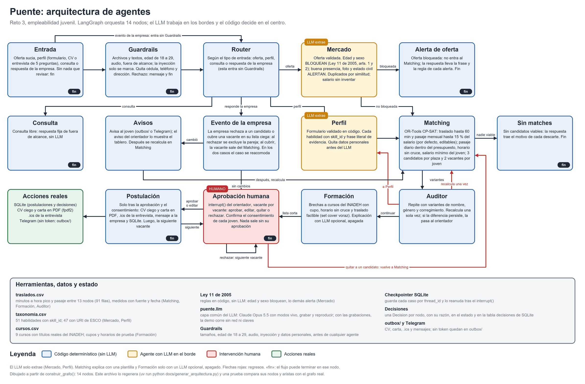

# Metodología de Puente

Reto 3, empleabilidad juvenil. Este documento explica cómo se despliega Puente, cómo funciona de principio a fin y cómo está construido. Lo que aún no existe en `main` se marca como "pendiente de #N" y se actualiza en el ensayo de #17.

## Despliegue

**Requisitos.** [uv](https://docs.astral.sh/uv/) y acceso a internet para instalar dependencias. `uv` descarga Python 3.12 si hace falta. No se necesita Docker ni servidor externo: todo corre en una sola máquina.

**Pasos.**

1. Clonar el repositorio y entrar a la carpeta.
2. `uv sync` instala las dependencias fijadas en `uv.lock`.
3. `cp .env.example .env` y llenar solo las claves que se tengan. `.env` nunca se sube al repo. Las variables están descritas en la sección "Credenciales de demo" del [README](../README.md).
4. `uv run pytest -q` corre las pruebas; no usan red ni claves.
5. Tablero del orientador: `uv run python -m app.server` y abrir http://127.0.0.1:8000.
6. Grafo: `uv run python -m puente.graph`. Hoy recorre los nodos vacíos; el flujo completo con el caso Yaritza queda pendiente de #10 y #12.

**Modo sin conexión o sin claves.** La demo debe poder correr sin red (ensayo de #17):

- Sin `GOOGLE_API_KEY` no se llama al LLM. Solver, reglas legales, Auditor y pruebas son código determinístico y funcionan igual. Los textos de explicación usan la plantilla de respaldo.
- Sin `TELEGRAM_BOT_TOKEN` el envío a la empresa se escribe en `outbox/` (mensaje de texto, CV en PDF y `.ics`), y el flujo no falla.
- Con `LANGSMITH_TRACING=false` no se envían trazas. La tabla `decisiones` de SQLite registrará cada decisión localmente (pendiente de #7, #10 y #12); hoy el tablero guarda las decisiones solo en memoria.

**Estado persistente.** El grafo usa un checkpointer SQLite (pendiente de #10) para reanudar tras el `interrupt()` del orientador. La base de perfiles, ofertas, postulaciones y decisiones vive en SQLite; su ruta se cambia con `PUENTE_DB` (variable de #7). Para reiniciar la demo desde cero se borra ese archivo y la carpeta `outbox/`.

## Funcionamiento

**Recorrido con el caso Yaritza** (perfil sintético: 20 años, La Chorrera, estudia de noche, sin CV, atiende la fonda de su mamá).

1. **Guardrails (#9).** Antes de cualquier agente se validan tamaños y tipos de archivo, se detecta inyección de instrucciones y se rechaza lo que está fuera de alcance. Las funciones ya están en `puente/guardrails.py`; conectarlas al grafo antes de los agentes está pendiente de #10.
2. **Mercado (#5).** Cada oferta sucia pasa a `Oferta` validada. El LLM solo extrae campos; las reglas son código:
   - Bloquean la oferta: un límite de edad (Ley 11 de 2005, art. 2) o la exigencia de sexo (art. 1).
   - Solo alertan, con la frase y la regla que las disparó: "buena presencia", foto, estado civil. La ley no menciona la apariencia, por eso no bloquean.
   - Las ofertas repetidas se descartan por hash.
3. **Perfil (#6).** Yaritza responde una entrevista corta de cinco preguntas porque no tiene CV. Antes de llamar al LLM se quitan cédula, teléfono y dirección exacta; solo queda el corregimiento. Cada habilidad lleva la frase que la evidencia y su `skill_id` de `data/taxonomia.csv` (pendiente de #3); lo que no está en la taxonomía se descarta y se registra.
4. **Matching (#4).** OR-Tools CP-SAT asigna con restricciones duras, sin LLM y con resultado reproducible:
   - Traslado <= 60 minutos desde el corregimiento del joven (`data/traslados.csv`, pendiente de #3). Mientras #3 no entregue `data/traslados.csv` y `data/cursos.csv` (medidos en Google Maps a hora pico, con fecha y método), el sistema usa tablas de respaldo estimadas en código (`puente/rules/traslados.py`, `puente/agents/formacion.py` y los casos fijos de `app/server.py`); no son mediciones.
   - Pasaje mensual <= 15 % del salario y <= el presupuesto del joven.
   - Horario compatible con sus clases.
   - Salario >= salario mínimo.
   - k = 3 vacantes propuestas por joven.
   El LLM solo redacta por qué cada match puntúa como puntúa; no cambia puntajes ni viabilidad.
5. **Auditor (#8).** Repite el matching con variantes contrafactuales de nombre y género. El corregimiento no se altera porque el traslado y el pasaje dependen legítimamente de dónde vive la persona. Si el resultado cambia, el grafo vuelve a Matching.
6. **Formación (#14, opcional).** Para las brechas de habilidades, propone cursos del INADEH (`data/cursos.csv`, pendiente de #3; hoy usa el catálogo estimado de respaldo en código) con cupo, horario sin cruce con las clases y traslado factible (set cover voraz).
7. **Orientador (#11), con `interrupt()`.** El grafo se detiene. En el tablero el orientador ve la lista corta, las ofertas bloqueadas con su motivo, las trazas, el embudo y el resultado del Auditor, y puede aprobar, editar, quitar un candidato o rechazar.
8. **Postulación (#7, #12).** Solo tras la aprobación se guarda en SQLite, se genera el CV en PDF con las habilidades que tienen evidencia, se envía la lista corta a la empresa por Telegram (o a `outbox/`) y se crea el `.ics` de la entrevista.

**Estados de una postulación.** `perfil_listo`, `preseleccionado`, `aprobado`, `enviado`, `entrevista`, `contratado`, `no_seleccionado`. El embudo del tablero cuenta cuántas hay en cada uno.

**Trazabilidad.** Cada nodo debe escribir una `Decision` en la tabla `decisiones`, y las llamadas al LLM y el recorrido del grafo irán a LangSmith (`LANGSMITH_PROJECT=puente`). Ambas cosas están pendientes de #7, #10 y #12: hoy `puente/tools/db.py` es un stub, los nodos del grafo están vacíos y no hay trazado explícito de LangSmith.

**Datos.** Los datos de personas son siempre sintéticos. Fuentes de cada archivo: `data/FUENTES.md` (pendiente de #3). Los traslados y cursos que muestra hoy el sistema son estimados de respaldo, no mediciones.

## Arquitectura

Diagrama: [`arquitectura.png`](arquitectura.png).

**Principio: LLM en los bordes, código en el centro.** El LLM lee texto sucio, entrevista, redacta y explica. El código decide todo lo que debe ser verificable: la legalidad de una oferta, el traslado, el pasaje, el horario, la asignación y la auditoría de sesgo. El LLM nunca ordena candidatos, nunca calcula traslados y nunca decide si una oferta es legal. Por eso `puente/solver/` y `puente/rules/` no importan ningún modelo de lenguaje, y las pruebas inyectan un doble en lugar del LLM.

**Módulos y su issue.**

| Módulo | Issue | Contenido |
|---|---|---|
| `puente/schemas.py` | #2 | Contratos Pydantic: `Oferta`, `Perfil`, `Match`, `Decision`, `EstadoPuente` y el enum de estados |
| `puente/graph.py` | #2, #10 | Grafo LangGraph; hoy nodos vacíos, router, `interrupt()` y checkpointer pendientes de #10 |
| `puente/guardrails.py` | #9 | Validación de entradas, inyección y fuera de alcance; su conexión al grafo está pendiente de #10 |
| `puente/agents/mercado.py`, `puente/rules/discriminacion.py`, `puente/rules/taxonomia.py` | #5 | Agente Mercado y reglas de la Ley 11 de 2005 |
| `puente/agents/perfil.py` | #6 | Agente Perfil |
| `puente/solver/asignacion.py`, `puente/rules/traslados.py`, `puente/agents/matching.py` | #4, #10 | CP-SAT, matriz de traslados y nodo Matching |
| `puente/agents/auditor.py` | #8 | Contrafactuales de nombre y género |
| `puente/agents/formacion.py` | #14 | Ruta de formación |
| `puente/tools/db.py`, `puente/tools/pdf.py`, `puente/tools/telegram.py`, `puente/tools/calendario.py`, `puente/agents/postulacion.py` | #7, #12 | SQLite, PDF, Telegram con respaldo, `.ics` y agente Postulación (pendiente de #7 y #12) |
| `app/server.py`, `app/static/` | #11 | Tablero del orientador (servidor ASGI con Starlette y HTML, CSS y JS) |
| `evals/run.py` | #13 | Runner de evals (pendiente de #13) |
| `README.md`, `docs/arquitectura.png`, `docs/metodologia.md`, `docs/bitacora_ia.md` | #15 | Entrega escrita |

**Contratos.** Los agentes se hablan solo a través de los modelos de `puente/schemas.py`. Ese archivo está congelado: cambiarlo exige un issue propio y actualizar todos los usos en el mismo PR. Cada nodo recibe `EstadoPuente` y devuelve un dict con las claves que cambia.

**Decisiones de diseño.** Quedan registradas en [`decisiones.md`](decisiones.md), una entrada por cambio de stack, arquitectura, alcance o forma de trabajo. La [bitácora de IA](bitacora_ia.md) registra qué se hizo con IA, con qué herramienta y qué se cambió a mano.

**Pruebas.** Sin red ni claves: la llamada al LLM vive detrás de una función o un objeto inyectable, Telegram también, y los archivos generados (SQLite, PDF, `outbox/`) se escriben en carpetas temporales. Los evals propios con resultado esperado escrito antes de correr son de #13.
