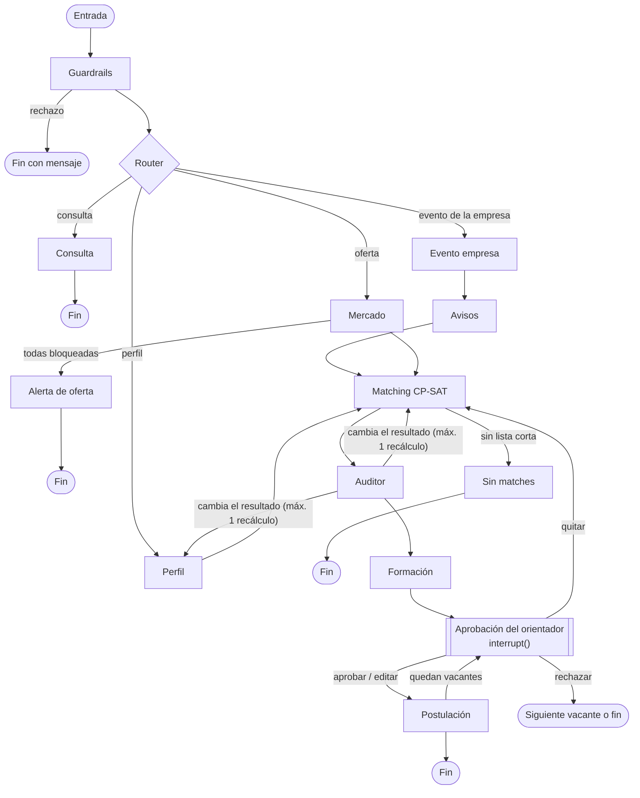

# Metodología de Puente

Reto 3 del Hackathon FISC 2026: empleabilidad juvenil. Puente ayuda a un orientador a conectar jóvenes de 18 a 29 años con vacantes que de verdad pueden tomar. Puede tomar una vacante quien llega en menos de una hora, paga el pasaje y cumple el horario sin perder sus clases. Este documento cubre:

1. [Arquitectura](#1-arquitectura): qué piezas hay y cómo se hablan.
2. [Funcionamiento](#2-funcionamiento): el recorrido de un caso, nodo por nodo.
3. [Despliegue](#3-despliegue): cómo se instala y se corre, también sin red y sin claves.
4. [Decisiones de diseño](#4-decisiones-de-diseño): qué decidimos y por qué.
5. [Límites](#5-límites): qué no hace, o hace a medias.

Todo lo que se describe está en `main`. Las cifras salen de archivos del repositorio, que se citan, o de una fuente externa con enlace. Si una pieza existe pero no está conectada a la demo, se dice.

---

## 1. Arquitectura

### Principio: el LLM en los bordes y el código en el centro

**El LLM** se usa para cuatro cosas:
- leer texto desordenado: ofertas copiadas de portales y respuestas de una entrevista;
- extraer campos;
- redactar;
- explicar.

**Todo lo que tiene que poder verificarse lo decide el código**, con la misma salida para la misma entrada:
- si una oferta es legal;
- el tiempo de traslado, el pasaje y el horario;
- la asignación de jóvenes a vacantes;
- la auditoría de sesgo.

Por eso `puente/solver/` y `puente/rules/` no importan ningún modelo de lenguaje. El LLM nunca ordena candidatos, nunca calcula traslados y nunca decide si una oferta es legal.

### Grafo de agentes

El flujo es un grafo de **LangGraph** (`puente/graph.py`, #10) con 14 nodos. Por defecto `construir_grafo()` usa los agentes reales (`nodos_fase_2()`). Los stubs de la fase 1 (`NODOS_FASE_1`) solo se usan para probar la mecánica del grafo.



### Módulos

| Módulo | Issues | Qué hace |
|---|---|---|
| `puente/schemas.py` | #2, #42 | Contratos Pydantic: `Oferta`, `Perfil`, `Match`, `Decision`, `EstadoPuente` y `EstadoPostulacion`, más `OfertaExtraida` y `PerfilExtraido`, que son lo único que produce el LLM. |
| `puente/graph.py` | #10, #12, #54 | Grafo, router, `interrupt()` del orientador, checkpointer SQLite, reacomodo por evento de la empresa y demo por terminal. |
| `puente/guardrails.py` | #9, #56, #128 | Validación de entradas y limpieza de datos personales, sin LLM. |
| `puente/llm.py` | #45, #125, #137 | Capa única de acceso al LLM: Claude por defecto, modos vivo, grabar y reproducir, tope de gasto y esquema simplificado para la salida estructurada. |
| `puente/agents/mercado.py`, `puente/rules/discriminacion.py`, `puente/rules/taxonomia.py` | #5, #43, #73, #75, #94, #117 | Extracción de ofertas, reglas de la Ley 11 de 2005, deduplicación y taxonomía. |
| `puente/agents/perfil.py` | #6, #44, #63 | Formulario fijo, CV o entrevista de 5 preguntas, y habilidades con evidencia literal. |
| `puente/solver/asignacion.py`, `puente/rules/traslados.py`, `puente/agents/matching.py` | #4, #48, #127 | Asignación con OR-Tools CP-SAT, matriz de traslados y explicación con plantilla. |
| `puente/agents/auditor.py` | #8, #50 | Variantes contrafactuales, línea base y tope de un recálculo. |
| `puente/agents/formacion.py` | #14, #53 | Cursos del INADEH para cerrar brechas: cobertura voraz de conjuntos (*set cover*). |
| `puente/agents/postulacion.py`, `puente/tools/` | #7, #12, #84 | SQLite, CV ciego en PDF, Telegram con respaldo en `outbox/`, `.ics` y agenda de la entrevista. |
| `puente/cargar.py` | #46 | Carga inicial de `data/` en `puente.db`. |
| `puente/metricas.py` | #47 | Indicadores ilustrativos con datos de la demo, rotulados como tales. |
| `app/server.py`, `app/static/` | #11, #33, #49, #52, #166 | Tablero del orientador (Starlette y Uvicorn, con HTML, CSS y JS sin framework) y vista del joven (`/joven`). |
| `evals/run.py`, `evals/casos.yaml` | #13, #129 | Evals propios, con el resultado esperado escrito antes de correr. |
| `puente/agents/horario.py`, `redactor.py`, `micromision.py` | #164, #157, #158 | Fase 1 de tres extensiones. No están conectadas al grafo ni al tablero; se usan desde su propia CLI y desde los evals (ver [Límites](#5-límites)). |

### Contratos y estado

- **Contratos.** Los agentes se hablan solo a través de los modelos de `puente/schemas.py`. Ese archivo está congelado: cambiarlo exige un issue propio y actualizar todos los usos en el mismo PR, como se hizo con los contratos v2 (#42).
- **Estado del caso.** Cada nodo recibe el estado y devuelve solo las claves que cambia.
- **Trazabilidad.** Cada decisión de un agente queda como un `Decision` (agente, resumen de entrada y de salida, razón y hora), que se agrega con `agregar_decision()`.

---

## 2. Funcionamiento

### Caso de la demo: Yaritza

**Yaritza** es un perfil sintético (`tests/fixtures/caso_yaritza.json`): 20 años, vive en La Chorrera (el caso usa «Barrio Colón», un alias que la tabla de alias resuelve a La Chorrera), estudia de 18:00 a 22:00 de lunes a viernes y atiende la fonda de su mamá por las mañanas. No tiene CV y pide un salario mínimo de 400 con un pasaje diario de hasta 3.00.

**Su recorrido**, nodo por nodo:

1. **Guardrails** (#9, #56, #128). Es el primer nodo y no usa LLM. Hace cuatro cosas:
   - **Rechaza con un mensaje claro:**
     - archivos que no son PDF, JPG o PNG, comprobando también la firma de los bytes;
     - archivos de más de 5 MB;
     - textos vacíos o de más de 10 000 caracteres;
     - edades fuera de 18 a 29;
     - notas de voz, con «Todavía no aceptamos notas de voz; escribe tu mensaje o sube un pdf, jpg o png».
   - **Responde «Solo atiendo empleo y formación»** a lo que está claramente fuera de alcance.
   - **Solo marca la inyección de instrucciones**: el texto sigue como dato, no como orden.
   - **Quita cédula, teléfono y dirección exacta** antes de que la lea cualquier agente (`limpiar_entrada`). Deja el corregimiento.

2. **Router.** Elige el camino según `tipo_entrada`:
   - una oferta va a Mercado;
   - un perfil va a Perfil;
   - un evento de la empresa va al reacomodo;
   - lo demás recibe la respuesta fija de consulta y termina.

3. **Mercado** (#5, #43). Convierte una oferta desordenada en una `Oferta` validada.
   - **El LLM solo extrae campos** a una `OfertaExtraida` (`extractor_claude`, vía `puente.llm`).
   - **El código decide todo lo demás:**
     - **Bloquean la oferta** el límite de edad (Ley 11 de 2005, art. 2) y la exigencia de sexo (art. 1). Una oferta bloqueada no entra al Matching.
     - **Solo alertan**, con la frase y la regla que las disparó, para que el orientador decida:
       - las demás causales del art. 1: raza, nacimiento, discapacidad, clase social, religión e ideas políticas;
       - el puesto o el estado civil escrito solo en femenino, como «cajera» o «soltera»;
       - «buena presencia», foto y estado civil.
     - **El salario** se acepta solo si la cifra aparece en el texto. Si no aparece, queda vacío, la oferta se marca «por confirmar» y nunca se inventa. Con el horario pasa lo mismo.
     - **Dos ofertas se unen como duplicadas** solo si cumplen todo esto:
       - el mismo puesto;
       - textos al menos 85 % parecidos;
       - ninguna empresa conocida distinta;
       - las dos bloqueadas o las dos no bloqueadas;
       - el mismo corregimiento. Si a una le falta, se exige 95 % de parecido.

       Gana la que llegó primero.
   - **Las habilidades** que no están en la taxonomía se descartan y quedan anotadas.

4. **Perfil** (#6, #44). Tiene cuatro partes:
   - **Formulario fijo validado en código:** nombre, género opcional, edad, corregimiento, horario de clases, horario libre, salario mínimo y presupuesto diario de pasaje.
   - **Entrevista de 5 preguntas** para quien no tiene CV, solo sobre lo que sabe hacer: el negocio de la familia, otros trabajos, voluntariado, qué sabe usar y en qué le piden ayuda.
   - **Limpieza antes del LLM:** se quitan cédula, teléfono y dirección y se conserva el corregimiento.
   - **Habilidades con evidencia:** el LLM devuelve un `PerfilExtraido`. Cada habilidad necesita un `skill_id` de la taxonomía y una frase **literal** del joven que la pruebe. Lo que no cumple se descarta con su motivo.

5. **Matching** (#4, #48). OR-Tools CP-SAT asigna sin LLM.
   - **Restricciones duras** por pareja de joven y vacante:
     - traslado de 60 minutos o menos;
     - pasaje mensual de ida y vuelta, por 22 días laborables, de hasta el 15 % del salario;
     - pasaje diario dentro del presupuesto del joven;
     - horario sin cruce con las clases y dentro del horario libre;
     - salario igual o mayor al mínimo que pide el joven;
     - al menos una habilidad en común, si la oferta pide habilidades;
     - hasta 3 candidatos por vacante y hasta 2 vacantes por joven.
   - **Si falta un dato** de la oferta, como el salario, el horario o las habilidades, no se descarta por ese dato. El par baja 10 puntos por cada dato que falta y queda «por confirmar». La excepción es el traslado: un par sin fila en la matriz de traslados no es viable.
   - **El puntaje** es la cobertura de habilidades. Los minutos de traslado no restan puntaje: filtran por el máximo y desempatan entre las vacantes de un mismo joven.
   - **La explicación** de cada match es una plantilla determinística, sin LLM.
   - **Ejemplo con Yaritza**, desde La Chorrera (`data/traslados.csv`):
     - Calidonia son 55 minutos con 1.85 de pasaje: entra.
     - Tocumen son 95 minutos: queda fuera.

6. **Auditor** (#8, #50). Repite la evaluación con variantes contrafactuales:
   - 7 pares de nombre y género, con la concordancia del texto ajustada;
   - otro corregimiento que **conserva la misma fila de traslados**. Así se mide si el resultado cambia solo por el nombre del lugar, sin tocar el traslado real, que sí es una restricción legítima.

   Una línea base de 3 corridas descuenta la variación propia del LLM. **Si una variante cambia el resultado, el grafo recalcula una sola vez. Si la diferencia persiste, no hay bucle:** pasa al orientador como alerta, con el texto «Tope de 1 recálculo alcanzado».

7. **Formación** (#14, #53). Para las brechas de habilidades, propone cursos de `data/cursos.csv` (9 cursos con títulos del INADEH). Cada curso tiene que cumplir:
   - tener cupo;
   - traslado de 60 minutos o menos;
   - pasaje dentro del presupuesto;
   - horario sin cruce con las clases.

   El algoritmo es una cobertura voraz de conjuntos: elige primero el curso que cierra más brechas y abre más vacantes.

8. **Aprobación del orientador** (`interrupt()`, #10, #11). El grafo se detiene en cada vacante con su lista corta.
   - **El orientador ve:**
     - la oferta, con sus alertas y lo que falta confirmar;
     - cada candidato, con su puntaje, sus brechas, la explicación y las rutas de formación;
     - las alertas del Auditor y el mensaje sugerido para la empresa.
   - **Tiene cuatro acciones:**
     - **Aprobar.**
     - **Editar:** cambia el mensaje a la empresa y su nota, sin recalcular.
     - **Quitar** a un candidato: el grafo vuelve a Matching y recalcula sin él.
     - **Rechazar** la vacante.
   - **Consentimiento:** solo se postula a quien tiene el consentimiento confirmado. Si el joven dijo «no», eso pesa más que la confirmación del orientador.

9. **Postulación** (#7, #12, #84). Solo corre después de la aprobación:
   - guarda perfil, oferta y postulación en SQLite y la avanza por sus estados, cada paso con su `Decision` en la tabla `decisiones`;
   - genera el CV ciego en PDF, solo con las habilidades que tienen evidencia;
   - elige una franja de entrevista sin choques y crea el `.ics` de 45 minutos;
   - envía la lista corta a la empresa por Telegram o, sin token, la escribe en `outbox/`.

10. **Reacomodo** (#54). La respuesta de la empresa entra como `evento_empresa`:
    - **Si rechaza a un candidato:** su postulación pasa a `no_seleccionado`, la pareja queda excluida, la vacante vuelve a estar pendiente y el Matching recalcula. El orientador aprueba la lista nueva en la misma pausa de siempre.
    - **Si la vacante se cubre:** sale del Matching.

    Los avisos al joven salen por Telegram o se escriben en `outbox/`. Funciona en el grafo y en la terminal; el tablero todavía no lo usa.

**Estados de una postulación:** `perfil_listo`, `preseleccionado`, `aprobado`, `consentido`, `enviado`, `entrevista`, `contratado` y `no_seleccionado`.

### Trazabilidad

- **Decisiones.** Cada nodo agrega un `Decision` al estado y el checkpointer las guarda con el caso. Al llegar a Postulación se copian a la tabla `decisiones` de SQLite. Al final, la demo por terminal imprime la cadena de agentes que decidieron.
- **LangSmith.** Se activa solo con `LANGSMITH_TRACING=true` y `LANGSMITH_API_KEY`. La demo por terminal pone `LANGSMITH_HIDE_INPUTS` y `LANGSMITH_HIDE_OUTPUTS` en `true` para no enviar datos personales.

### Datos

Toda persona en los datos es sintética. `data/FUENTES.md` documenta la fuente de cada archivo y separa tres tipos de dato:

- **Dato medido:**
  - **Traslados** (`data/traslados.csv`): 13 corregimientos y 91 filas, medidos a las 07:00 en Google Maps Transit y Moovit con las tarifas de MiBus, el Metro y la ATTT.
  - **Ofertas** (`data/ofertas/`): 20 anuncios reales de Computrabajo (14) y Konzerta (6), con empresas renombradas como empresas de prueba.
- **Dato de prueba:**
  - los 10 perfiles de `data/perfiles/`;
  - los pares de duplicados;
  - los cupos y horarios de los cursos.
- **Supuesto del equipo:**
  - los umbrales de 60 minutos y 15 %;
  - los 22 días laborables;
  - la simetría de ida y vuelta.

La taxonomía (`data/taxonomia.csv`) tiene 51 habilidades:
- 47 están enlazadas a una URI de ESCO verificada.
- 4 son identificadores propios sin URI (`cocina`, `comunicacion_efectiva`, `excel` y `ventas`), declarados como supuesto del equipo (#76).

---

## 3. Despliegue

Todo corre en una sola máquina, sin Docker ni servidor externo.

**Requisitos.** [uv](https://docs.astral.sh/uv/) y acceso a internet para instalar dependencias. `uv` descarga Python 3.12 si hace falta.

```bash
uv sync                       # dependencias fijadas en uv.lock
cp .env.example .env          # llenar solo lo que se tenga; .env nunca se sube
uv run pytest -q              # pruebas sin red ni claves
```

**Demo del grafo con el caso Yaritza, por terminal:**

```bash
uv run python -m puente.graph
```

- **`--llm`**:
  - `grabado`, el valor por defecto, usa las respuestas guardadas en el caso, así que no necesita red ni clave.
  - `claude` llama a Claude a través de `puente.llm`.
- **`--auto`** decide sin preguntar, por ejemplo `--auto "aprobar,aprobar,empresa_rechaza:yaritza@of-cajero-vista-alegre,aprobar"`. Sin esta opción, la demo pregunta en cada vacante.
- **`--telegram`** es la única forma de que algo salga por Telegram. Sin esta opción, todo se escribe en `outbox/`.

**Otras piezas:**

```bash
uv run python -m puente.cargar                 # carga data/ en puente.db (#46)
uv run python -m puente.agents.perfil --entrevista   # entrevista de Perfil por terminal
uv run python -m app.server                    # tablero en http://127.0.0.1:8000 (vista del joven en /joven)
uv run python -m evals.run                     # evals (escribe evals/resultados.md)
```

### Modo sin red y sin claves

- **Grabaciones.** La capa común de LLM (`puente/llm.py`) tiene tres modos, que se eligen con `LLM_MODO`:
  - `vivo` llama al modelo;
  - `grabar` llama y guarda la respuesta en `data/grabaciones/`;
  - `reproducir` solo lee las grabaciones, así que no usa red ni clave.

  La clave de cada grabación es un hash de proveedor, modelo, prompt y esquema, de modo que un cambio de prompt o de modelo invalida la grabación.
  - **Carga sin red:** `LLM_MODO=reproducir uv run python -m puente.cargar` carga las 20 ofertas grabadas (7 bloqueadas) y los 10 perfiles (`data/grabaciones/README.md`).
  - **Evals y CI:** los evals reproducen sus grabaciones desde `evals/grabaciones/`, y el CI corre con `LLM_MODO=reproducir`.
- **Sin clave en modo vivo,** el error es claro: `ErrorLLM` con «Falta ANTHROPIC_API_KEY… use LLM_MODO=reproducir». No se cae el proceso.
- **Sin `TELEGRAM_BOT_TOKEN`,** los mensajes a la empresa y al joven se escriben en `outbox/` y el flujo no falla.
- **Tope de gasto.** `PUENTE_LLM_TOPE_USD` fija un gasto estimado máximo por proceso, que se comprueba antes de cada llamada real.
- **Las pruebas** fijan `LLM_MODO=reproducir`, no leen `.env`, borran las variables de Telegram y escriben la base y `outbox/` en carpetas temporales (`tests/conftest.py`).

### Estado persistente

| Archivo | Por defecto | Variable | Contenido |
|---|---|---|---|
| Base de Puente | `puente.db` | `PUENTE_DB` | Perfiles, ofertas, postulaciones con su historial, `decisiones`, `descartes` y `cargas` |
| Checkpoints del grafo | `checkpoints.db` | `PUENTE_CHECKPOINTS` | Cada caso por `thread_id`, para retomarlo después del `interrupt()` |
| Salida de mensajes | `outbox/` | `PUENTE_OUTBOX` | Mensajes a la empresa y al joven cuando no hay Telegram |

Para repetir la demo desde cero se usa otra `PUENTE_DB` o se borran esos archivos.

---

## 4. Decisiones de diseño

El registro completo está en [`decisiones.md`](decisiones.md). El horario y las decisiones del 16 de octubre están en el issue #41. Las decisiones que dan forma al producto son estas:

1. **LLM en los bordes, código en el centro.**
   - **Por qué:** un modelo de lenguaje no da la misma respuesta dos veces, ni explica de forma verificable por qué descartó a alguien. La legalidad, el traslado, el pasaje, el horario, la asignación y la auditoría tienen que dar la misma salida con la misma entrada.
   - **Cómo se aplica:** el LLM solo produce `OfertaExtraida` y `PerfilExtraido`; todo lo demás es código. Hasta la explicación del match es una plantilla determinística (#48).
2. **El traslado filtra y desempata, pero no pone a competir a unos jóvenes contra otros.**
   - **Por qué:** vivir lejos no debe dejar a nadie detrás de otro joven igual de apto para la misma vacante.
   - **Cómo se aplica:** los minutos descartan lo que el joven no puede alcanzar y desempatan entre las opciones de ese mismo joven. No restan puntaje: el peso por minuto es 0. El Auditor comprueba que cambiar solo el corregimiento, con el mismo traslado, no cambie el resultado.
3. **El humano decide al final y el sistema no entra en bucles.**
   - **Por qué:** nada sale hacia una empresa sin que una persona lo apruebe, y un sistema que recalcula sin fin no es confiable.
   - **Cómo se aplica:**
     - el grafo se detiene con `interrupt()` en cada vacante;
     - el Auditor recalcula una sola vez y, si el sesgo persiste, se lo muestra al orientador;
     - «editar» cambia el mensaje y la nota, no el cálculo; «quitar» sí recalcula.
4. **Consentimiento del joven y CV ciego.**
   - **Por qué:** el joven decide si su CV llega a una empresa, y la empresa no debe recibir datos que permitan discriminar antes de la entrevista.
   - **Cómo se aplica:** solo se postula a quien consintió, y el «no» del joven pesa más que la confirmación del orientador (#54). El CV quita corregimiento, edad, género, foto, estado civil y nacimiento (#148), además de cédula, teléfono y dirección. Todavía lleva el nombre del joven (ver [Límites](#5-límites)).
5. **Datos de prueba rotulados.**
   - **Por qué:** ninguna cifra de prueba puede presentarse como medición real.
   - **Cómo se aplica:** las personas son sintéticas y las empresas llevan nombres de prueba. Los cupos y horarios de los cursos son datos de prueba. Los traslados están medidos, con fuente y fecha. Los umbrales se declaran como supuestos del equipo (`data/FUENTES.md`). Las métricas del tablero dicen «Ilustrativo, datos de la demo» (`puente/metricas.py`).
6. **Robustez antes que adorno.**
   - **Por qué:** en una demo en vivo, un dato inventado o una caída cuestan más que una función menos.
   - **Cómo se aplica:**
     - un salario que no aparece en la oferta queda vacío y marcado;
     - un par sin dato de traslado no es viable;
     - Telegram sin token escribe en `outbox/`;
     - el modo reproducir permite correr sin red;
     - la inyección se marca, pero la defensa real es la salida estructurada y que decida el código.
7. **Menores de 18 años fuera de la demo, como trabajo futuro.**
   - **Por qué:** contratar a menores de edad tiene reglas propias que el sistema todavía no modela.
   - **Cómo se aplica:** el guardrail rechaza edades fuera de 18 a 29.
8. **Un solo modelo detrás de una sola puerta.**
   - **Por qué:** cambiar de proveedor o de modelo no debe tocar a los agentes, y la demo necesita poder correr sin red.
   - **Cómo se aplica:** el modelo es Claude Opus 5.5 (`claude-opus-5-5`) con el crédito del equipo, detrás de `puente/llm.py` (#45, #41), con Gemini como respaldo opcional (`LLM_PROVEEDOR=gemini`). Ningún agente crea su propio cliente.
9. **Tablero en Starlette y Uvicorn, no en Streamlit.**
   - **Por qué:** Streamlit vuelve a ejecutar todo el programa en cada clic, y eso complica controlar la pausa del orientador (`interrupt()`) y probar el tablero de punta a punta por HTTP.
   - **Cómo se aplica:** el tablero es un servidor web (Starlette y Uvicorn) con páginas en HTML, CSS y JavaScript sin framework (#11, #33).

---

## 5. Límites

- **Entrevista simulada: fuera de alcance.** Puente no ensaya entrevistas de trabajo con el joven. La entrevista de Perfil solo sirve para conocer sus habilidades.
- **Tendencias del mercado: no implementadas.** No hay análisis de demanda por ocupación ni series en el tiempo; Mercado procesa ofertas una por una.
- **El determinismo vale a la escala de la demo.** El solver usa 1 hilo, semilla fija (42) y orden por id, así que con la misma entrada da el mismo resultado. Pero la búsqueda se corta a los 1.8 segundos (`max_time_in_seconds`). Con los datos de la demo llega al resultado antes de ese corte. Con muchos más jóvenes y vacantes, el corte podría dejar una asignación distinta según la máquina.
- **El tablero usa stubs de Mercado y Perfil.** Construye el grafo con `stub_mercado` y `stub_perfil` (`app/server.py`, en la función que arma el grafo del tablero). Sus ofertas y perfiles vienen sembrados en el código o del formulario: pasan por las reglas de la Ley 11 y por los guardrails, pero sin extracción por LLM. El Matching, el Auditor, Formación y Postulación del tablero sí son reales. La vista `/joven` usa el agente Perfil real.
- **La demo por terminal no pasa por Mercado.** El caso Yaritza entra como perfil, con las ofertas ya cargadas, y por defecto usa respuestas grabadas (`--llm grabado`). La extracción real de ofertas se ve con `puente.cargar`.
- **El reacomodo** (#54) funciona en el grafo y en la terminal, pero el tablero todavía no envía eventos de la empresa.
- **El CV ciego todavía lleva el nombre** del joven, que es ficticio en la demo. El mensaje a la empresa también lo nombra.
- **El Auditor dentro del grafo** recalcula el Matching con las variantes, pero no vuelve a correr el LLM de Perfil. Por eso mide que el solver no dependa del nombre, el género o el corregimiento. Hoy nada mide si el nombre cambia lo que extrae el LLM de Perfil: los evals de sesgo tampoco usan LLM.
- **Tres extensiones en fase 1 sin conectar.** El horario desde la tirilla de matrícula (#164), el redactor de una versión legal de la oferta (#157) y la micro-misión con *scorecard* ciego (#158) existen como módulos con su CLI y sus evals, pero no están en el grafo ni en el tablero.
- **Notas de voz:** se rechazan con un mensaje claro hasta que exista #55.
- **Extracción de ofertas por debajo de la meta en los evals.** La última corrida guardada (`evals/resultados.md`, generado el 16 de octubre a las 23:24) da 29 casos bien y 4 fallos de 33. Los 4 fallos son de extracción de ofertas: 1 acierto de 5 (20 %) contra una meta de 80 %. Ese archivo es anterior a los casos de horario, redactor y micro-misión: `evals/casos.yaml` ya tiene 42 casos en 10 categorías, y `resultados.md` se vuelve a generar en el ensayo (#17). Las metas por categoría son propuestas del equipo.
- **Cobertura geográfica:** la matriz de traslados tiene 13 corregimientos del corredor Panamá Oeste, Centro, San Miguelito y Este. Diez de las 20 ofertas no indican un lugar de esa matriz, así que el Matching no las puede asignar (`data/FUENTES.md`).
